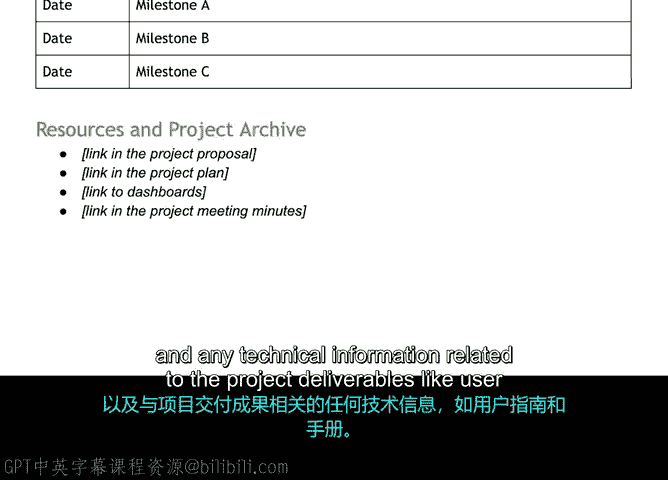

# 谷歌项目管理：专业证书 第4课：《项目执行：推动项目》｜project-execution-google｜ - P60：60_06_05_面向项目经理的收尾流程.zh_en - GPT中英字幕课程资源 - BV1Eu4y1i7Zk

Welcome back， let's discuss what the project closure process means for you， the project manager。

For a project manager， it's important to close a project properly for a number of reasons。

 closinging provides an opportunity to reflect on how you and your team performed。

 ensuresure every task is completed and prevent confusion around the project in the future。

I'll detail the importance of these closing practices as well as the necessary documentation to successfully close a project。

One of the most important aspects of thoroughly closing a project is the project closeout report。

A project closeout report is a document created by project managers for project managers。

 A project closeout report serves three major purposes。 First。

 it's a blueprint to document what the team did， how they did it and what they delivered。Second。

 it provides an evaluation of the quality of work。And third。

 it evaluates the project's performance with respect to budget and schedule。

Similar to the retrospective， the project closeout report can be used to determine best practices when it comes to future projects。

Think of it as a transfer of knowledge from you to future project managers。For instance。

 once a project closes， there's a chance a similar project or a continuation of that project will come up within the organization。

 and maybe a different project manager is assigned to this new project while you go on other things。

If you create an in depth closeout report， it will help the newly assigned project manager immensely to know what happened previously on a similar project。

Your close out report could include things that worked out well and things that didn't work out so well。

 Cating a close out report will also reduce the time you spend answering questions as the new project manager gets up to speed。

It's safe to assume that the people reading your report in the future will be unfamiliar with the project。

 So be as detailed as possible。 That way， the new project team will be able to form an understanding of the purpose。

 execution and outcome of the project based on your report alone。In your project closeout report。

 you will want to include the following things， an executive summary。

 This means a description of the process and what the purpose of the project was。

 This should be short and concise。 A few sentences to a paragraph maximum。

If an executive didn't have time to read the entire document and only had time to read this executive summary。

 would they be able to understand the project highlights？A list of key accomplishments。

 Think of this as a way to highlight the team's accomplishments。

 as well as the overall impact of the project。😊，Include any lessons learned。

 like what went well and why， what went wrong and why。

 What were the major effects of key problem areas such as scope creep and schedule slip。

Any open items， this could be things you didn't quite get to or ideas for changes you'd make if you had had the time。

Your next step， things like， are there expected follow up projects and is there any ongoing maintenance required。

You also want to include important information about the schedule and important deadlines。

 like what were your milestones and how did you choose them， How long did the project take。

 Did the project stay on track and any information about major setbacks。

Be sure to list resources and team members。 Explain who is involved and what their roles were。

 This is also a key way to acknowledge people who contributed to the project's completion。

 and finally， include a resources and project archive section。

 This will include links to things like your original project plan。

 any documented stakeholder communication and feedback like meeting notes。

 Any documentation used to track， monitor and report and any technical information related to the project deliverables like user guides and manuals。

Hopefully by now， you understand how project closeout reports are beneficial to not only the organization。

 but the project manager as well。Project closeout reports promote visibility among team members and create more efficient future projects。

All right。 we've covered a lot of information。 Great job for sticking with it。 In the next video。

 we'll revisit the concepts you've learned as we recap the module。😊。

