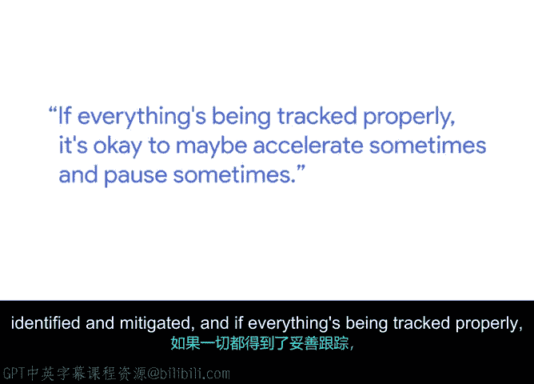

# 谷歌项目管理：专业证书 第4课：《项目执行：推动项目》｜project-execution-google｜ - P6：06_01_06_Pranjal-多轨道管理.zh_en - GPT中英字幕课程资源 - BV1Eu4y1i7Zk

Hi， my name is Bjll and I work as a program manager in the S reliability Engineering orRC。

 you can also call it SRE。😊，What SR does is they are primarily responsible for all the critical services within Google and in case something goes wrong。

 we are the first line of defense。 I think I can talk about the first big project I managed at Google Mike Techled and I co-founded this project about three years ago and I continue to work on it as of right now So the project what we wanted to do in terms of ambition was we wanted to generalize some tooling to help mobile apps be reliable in production。

 So what that means is let's say you're using a mobile app we want to make sure that in case something goes wrong。

 we detected it before the user does and we take action before the user even knows that something's wrong behind the scenes right。

😊，So we started out with this project and my biggest fear in terms of working on this project was managing a trade off between ambition and project quality so when we did our brainstorming sessions and we wrote out a roadmap it just seemed a bit too overwhelming the scale at which we were planning to work I think I would be really thankful to my manager at the time she said she gave me some really good advice she said in case you have let's say five different tracks going on in a very big project。

😊，Not all five tracks have to be worked on every single day。

 You could probably take out a quarter and make super good progress on maybe track 3 and track 5。

 whereas you can bootstrap the other tracks to make progress on it in the next quarter So that gave me a bit of peace of mind and she also empowered me to think in terms of I'm in a position as a program manager to push and pull on those priorities as long as people are aware of what we are working on what risks need to be identified and mitigated and if everything is being tracked properly it's okay to maybe accelerate sometimes and pause sometimes。

😊。

In fact， I learned that zooming out and pausing sometimes can result in original ideas and then also gives people a little bit of a breather。

😊。