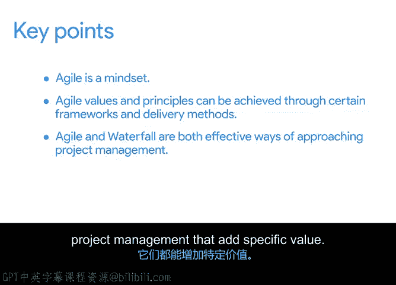

# 谷歌项目管理：专业证书 第5课：《敏捷项目管理课程（Google）》｜agile-project-management｜ - P10：10_01_04_混合项目管理方法.zh_en - GPT中英字幕课程资源 - BV1cF411C7kN

Hello， in the last video， we reviewed a few of the more popular methods for applying Agile values and principles to your projects。

We explored Kanban， which focuses on visualization and managing flow。XP。

 which is concerned with taking product development best practices to an extreme degree and lean。

 which actually predates Agile and aims to capture core principles that eliminate waste and deliver value to customers。

We've also compared Agile to waterfall to form a better understanding of what each approach values or tries to accomplish and what kinds of projects they work best with。

Throughout these videos， we've explored Agile project management in a couple of different ways。

 First， we explored Agile as a way of thinking about the project delivery process through the values and principles outlined in the Agile manifesto。

😊，Second， we explored Agile through different project delivery frameworks and methods like Kban， X。

 P and Le， and especially through Scrum。These two ways of applying agile demonstrate that the real power of agile comes from not only adopting certain processes or strategies。

 but also from adopting a certain kind of mindset， one that is necessarily different from the traditional waterfall models。

 This means that you can still get some benefits from thinking in an agile way。

 and seek to apply those agile values and principles from the agile manifesto。

 even when you need to use a waterfall delivery approach。

So with all this agile stuff bubbling around your heads。

 let's do a quick recap on some of the key tenets of traditional waterfall project management。

Then we'll explore some of the ways you can blend the methods and approaches you've just learned about to best fit the needs of a specific project。

 As we learned in earlier courses， a waterfall project life cycle is made up of the following phases。

 initiation， planning， executing and completing tasks and closing out the project。

 and all of the tasks within each of these phases like identifying goals and scope， scheduling。

 budgeting and risk management。Agile project management includes most of the same phases and tasks。

 They're just done in different ways。 So even though these two approaches have clear differences。

 blending them might make a lot of sense， depending on the type of project or project team you' are working with。

Here are some reasons you might want to blend agile and waterfall styles。Your stakeholders。

 customers or sponsors are more comfortable with traditional approaches and using workflows or delivering traditional work products is easier for them to understand and follow。

But your project team is already established in Scrum and they wish to continue。

Maybe there are regulatory requirements that insist on certain traditional work processes。

 such as large requirement documents for certifications。

Or it could be that one of the vendors involved in a large project is already following a traditional approach and the integration between the teams requires some blending of methods。

In these cases， a project manager might choose to blend aspects of waterfall and agile so that different parts of the project can be worked on in ways that meet project requirements。

 but don't negatively impact other parts of the project， or the project as a whole。

Let's explore some more examples of how to blend methods。

Let's say your project is to develop a software product during the retrospective for the last sprint。

 a team member says， I need to implement a certain feature。

 but I don't have much experience building that particular feature。

Some one else on the team is an expert on that feature。

 So you decide to pair them up so they can work on building the feature together during the next sprint。

 You've just blended X， P and scrum。XP provides the basis for working in pairs from pair programming。

 and retrospectives are a key component of scrum。Here's another incredibly common example。

 most scrum teams I know use a conban board to track their progress through their sprint。

One word of warning， though。 Watch out for too much change in how you do things。

 Teams work best when they can build up some consistency。

Let's come back to Office Green as project manager of Virtual Verde。

 what types of methods might you want to use to get the project started。

 where would you blend some traditional methods and agile methods？Here are some factors to consider。

 The existing plant suppliers are used to dealing with the original plantt Pell's office delivery team。

 Some of them might be interested in experimenting with an agile approach， but not all。In this case。

 you'll want to include those vendors in discussions early on to gain buy in and address any concerns。

Office Green also needs to really watch their costs。

 so you'll want to use traditional budget management controls to make sure they don't go over budget on their program。

While that brings us to the end of this video， let's review the key points I want you to take with you。

 First， Agile is a mindset， a way of thinking about the project delivery process through the values and principles outlined in the Agile manifesto。

Second， Agile values and principles can be achieved through certain frameworks and delivery methods like Scrum。

 Kban， XP， and leanan。And finally， Agile and waterfall are both effective ways of approaching project management that adds specific value。

There are times when blending these styles will add even more value than sticking with just one。

 so don't be afraid to mix things up。As long as different parts of the project can benefit from certain processes without negatively impacting the project as a whole。

 go for it。Coming up， I'll teach you all about Scrum teams and how to use Scrum as a framework for running a successful project。

 it's going to be fun to take you on this journey。