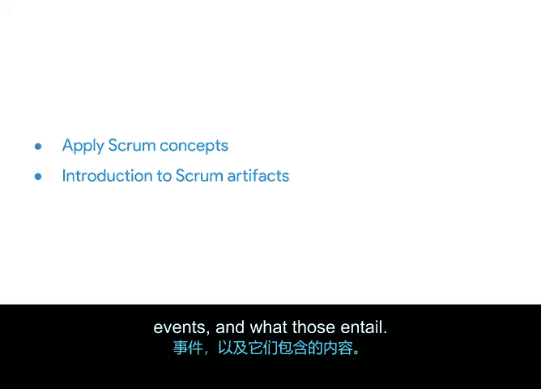

# 谷歌项目管理：专业证书 第5课：《敏捷项目管理课程（Google）》｜agile-project-management｜ - P12：12_02_01_简介-Scrum基础.zh_en - GPT中英字幕课程资源 - BV1cF411C7kN

Hi there Earl we gave you an overview of the Agile mindset。

 which is based on the Agile Manoss four values and 12 principles， we covered the Agile values。

 principles and a set of agile methodologies that we can use to manage projects in an agile way。

Now we're going to have a deep discussion about Scrum， the most commonly used Agile framework。

The Scrum guide， which contains everything you need to know about Scrum。

 is a main source of truth for scrum teams and is available for free at scrumguides。org。

We've also linked to it in the course resources。I'll often refer back to what said in the definitive Scrum guide。

 so please bookmark that site for future reference。

The majority of my agile project management experience is in Scrum and fortunately for me。

 Scrum is used a lot at Google， Scrum is so prevalent that people sometimes use the term Scrum and agile interchangeably。

 to make this really clear， agile is the foundational philosophy and mindset while scrum is a framework that materializes or brings that philosophy to life。

In fact， Scrum came before the Agile Manesto and served as an inspiration for the entire Agile philosophy。

For the rest of this course， we'll focus on Scrum， which is the most popular project management framework。

We also mentioned other frameworks in the last module。

 which you're welcome to revisit anytime as needed。Okay， let's discuss scumb。

We're going to start by exploring the theory behind Scrum， which has three pillars。

 and we'll explore the five scrum values。I'll tell you why it's important for teams to have a set mission that they follow。

I'll also introduce the roles within a Scrum team， the product owner， Scrum master。

 and the development team。Lastly， I'm going to introduce all of these concepts to you using our new Office Green project。

 you probably remember Office Green as a company that handles plants and greenery for office buildings。

 while Office Green has a new project in the works called Virtual Verde。

 but we'll get into that later。You also learned that in Scrum projects。

 project managers typically take on the Scrum master role。

 so in this scenario you'll be the Scrum master working with the Scrum team and you'll learn about Scrum artifacts。

 events， and what those entail。

We're going to start with the three pillars of Scrum theory， meet you in the next video。

