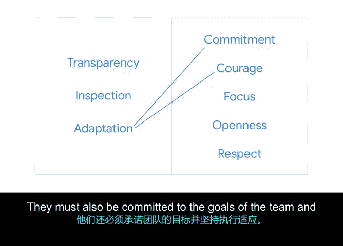

# 谷歌项目管理：专业证书 第5课：《敏捷项目管理课程（Google）》｜agile-project-management｜ - P14：14_02_03_Scrum的五大价值观.zh_en - GPT中英字幕课程资源 - BV1cF411C7kN

Hello again。In the previous video， we discussed scrum theory and explored the three pillars of scrum。

In this video， we're going to talk about the five values of scrum and how they relate to the three pillars。

Having a value system as a team is great because you'll expect each other to act in a way that is aligned with these values。

 so let's get into it。Scrrum teams work and behave according to five core values， commitment。

 courage， focus， openness and respect。First， there's commitment this means personally committing to achieving the goals of the scrum team。

 for example， maybe a member of the team is struggling to overcome something that is blocking their work from getting done。

 like a new technology that is proving difficult to learn。In this case。

 another team member who is familiar with the technology can put their own work aside to step in and help their teammate learn the technology the second value is courage Scrum team members must have the courage to do the right thing and work on tough problems in any project there's a body of work that needs to get done some of the work will be relatively simple and some will be complex with many risks。

An example of courage includes taking on a hard task that you know will require you to learn a new skill。

Courage could mean telling your team that you're stuck and you need help。

It might also mean calling out a negative behavior within the team to openly discuss and address the behavior。

Demonsstrating courage when responding to challenging situations can strengthen the team's resilience。

Third， there's focus this refers to everyone focusing on the necessary work within the sprint and the overall goals of the scrum team for example。

 a team member is working on a solution that involves a new technology and is very difficult allowing that team member to focus on that difficult yet necessary part of the solution is key and their teammates help get it across the finish line。

 they know that focusing on this solution will speed up the team's progress in the long run so it's worth the investment now。

The Scrum master， a role often assumed by the project manager。

 helps the team to focus on the sprint and product goals by facilitating their activities and events on a daily basis。

The fourth value is openness。For Scrum to work， the team and its stakeholders agree to be open about all the work and the various challenges that come with performing the work。

Openness is essential to a productive scrum team in order to gather data。

 team members must be willing to share their observations and experiences。

 if a team member runs into an issue within the project that they aren't sure how to fix。

 they should share it with the team。 another team member may have a very quick and easy solution。

 or at least valuable insight into some options on how to handle their issue。

The fifth and final scrum pillar is respect。 Tea members should respect the opinions。

 skills and independence of their teammates。 When you respect the independence and contributions of others and feel respected yourself。

 you're more likely to listen and hear any feedback。

 This is crucial in making the product or business as successful as possible。

In order for a team to bring the three pillars of scrum to life。

 they must act in accordance with the five scrum values。 For example。

 if a team aims to achieve transparency between themselves and their stakeholders。

 they need to be open to sharing information while still having the focus to share the most relevant information。

For a team to effectively inspect their work and their processes。

 they must have courage to offer difficult feedback and have the mutual respect to really listen to what others have to say。

For a team to adapt to their inspection results， they must have the courage to make changes and learn from them。

 They must also be committed to the goals of the team and follow through on the adaptation。

Amazing we've now covered the foundational pillars and values behind a scrum team。

 we've also covered how the team supports scrum values as they relate to Agile。

Meet me in the next video where we'll discuss specific scrum roles on a team。

