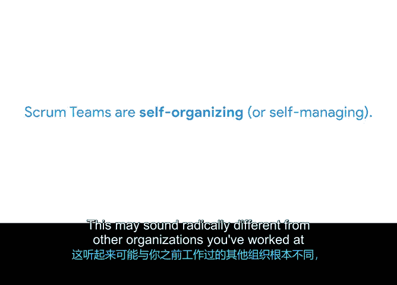
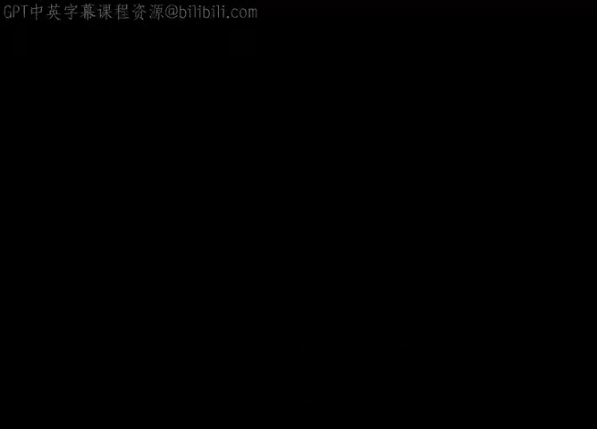

# 谷歌项目管理：专业证书 第5课：《敏捷项目管理课程（Google）》｜agile-project-management｜ - P15：15_02_01_核心Scrum角色.zh_en - GPT中英字幕课程资源 - BV1cF411C7kN

Hello again。Now that we've covered the theory behind Scrum。

 the next few videos will focus on the three scrum roles that make up the scrum team。

 their respective traits， and the Scrum team's mission。

If you think of a team in the context of a team sport like soccer in the United States or football for our global learners。

 each position plays a certain role。 you have strikers， wingers， defenders， goalkeepers， and more。

Each player has their own responsibilities they must fulfill in order to try to win the game。

The same is true for scrum teams。 and just like our scrum name inspiration， the sport of rugby。

 the team is working towards a specific objective to win。

Let's start by discussing the team's product， vision and mission。 Remember。

 Scrum is an agile methodology， so it embodies the values and principles of agile。

One of the agile principles states，  build projects around motivated individuals。

 give them the environment and support they need， and trust them to get the job done。

The best way to motivate individuals is to give them a mission and product vision that they really care about so they can feel good about working towards it。

In Agile， a mission is a short statement that stays constant for your team throughout the process and gives them something to work toward。

In addition to the mission， an agile team will also set a product vision。

 making it clear what outcomes the team is responsible for and where your team's boundaries are。

This may sound a bit like management speak， but I like to think about it this way。

A mission tells me why we're doing the work。 A product vision helps me imagine what the work will be like when we're done。

Let's think about the mission and product vision with Office Green's new virtualrtual Verity project。

Virtual Verde delivers plants to people's home offices。

 Office Green's business development department came up with a mission for the project。

 Virtual Verde improves users' health and happiness by bringing their at home workspace to life。😊。

A product vision created by the Scrum team might be Virtual Verde is a living marketplace that transforms the home office。

These two statements are meant to inspire the team to deliver a delightful experience for virtual Verday's users。

Now let's discuss scrum team roles。 Every scrum team consists of three defined roles， a scrum master。

 a product owner， and a development team。These roles work together to achieve the team's objectives and realize the mission and vision。

The product owner is responsible for what a team builds。

 They also must ensure everyone understands the why。 For example。

 the virtual Verde team needs a product owner to capture and promote the great ideas coming from the team about the new service。

 which is delivering plants to people who work from home。

The product owner's job is to build the right thing。

The development team is responsible for how a team will deliver that product。 For example。

 creating a new website is next on our to do list so customers can order plants for the home office。

The development team is building websites， integrating billing systems and fixing issues。

 The development team's job is to build the thing， right。

The scrum master is responsible for when a team will deliver value to its users。

 This role is roughly equivalent to the project manager role in traditional projects。

 The virtual Verde Scrum master is helping unblock the team from getting things done。

 such as finding out why a vendor was late or helping the team prioritize issues from users or organizing the demo for the CEO。

 The Scrum master's job is to build the thing fast。

Although there are clearly defined roles on a scrum team。

 it's important to note that the entire team works together to achieve its goals， In other words。

 although there are specific expectations for each role。

 the development team may still contribute ideas for the what and the when of a project。

 while the product owner may contribute to discussions on the how of the project。As a collective。

 scrum teams must exhibit a few specific skills， the Scrum guide details these skills as follows。

Scrrum teams are cross functional。 When a scrum team delivers something。

 it's the accomplishment of the entire team。 no matter what function or organization they're in on your scrum team。

 you may have a software developer， a marketing specialist， quality assurance and logistics expert。😊。

You may remember our soccer team analogy when each player comes together to play their position。

 the end result is you have all you need to get the ball into the goal。

 plus these fresh perspectives add a lot of value to your project and to your users and business。

Scrrum teams are self organizing。 This may sound radically different from other organizations you've worked at before。

 where your managers dictate your tasks and request frequent updates。

 but because scrum teams rely on those five values， commitment， courage， focus， openness and respect。

 the scrum team is able to work together to deliver amazing results in a more organic and flexible environment。

Although teams are self organizing， high performing scrum teams often have a manager who sits outside of the scrum team and provides strategic leadership and individual career development without disrupting the self organizing nature of scrum。

In my experience， if a manager feels compelled to start telling the team what to do and interferes with this self organizing nature。

 the benefits of scrum will begin to collapse。Now that you have a better understanding of what constitutes a scrum team willll take you through the specifics of each role in the next few videos。

 We'll start with the traits of an effective scrum master。

