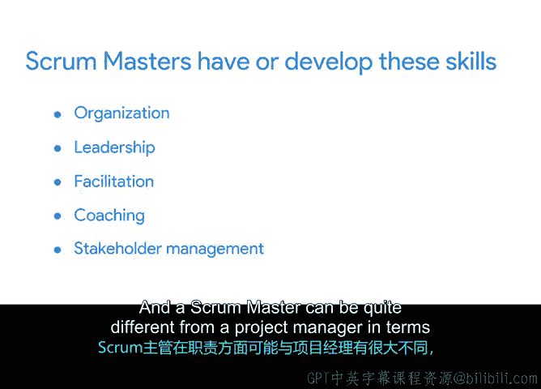

# 谷歌项目管理：专业证书 第5课：《敏捷项目管理课程（Google）》｜agile-project-management｜ - P16：16_02_02_高效Scrum Master的特征.zh_en - GPT中英字幕课程资源 - BV1cF411C7kN

Welcome back。We've already mentioned that in Scrum。

 the project manager is most likely playing the role of Scrum master。

 So what exactly does the scrum master role entail。In this video。

 I'll further define what a scrum master is。 Then I'll explain some of the differences and similarities between a scrum master and a project manager。

 The scrum master promotes and supports the scrum process by helping everyone understand and implement Scrum。

This includes its practices， rules and values。 My favorite way to describe the role of a scrum master is that they're responsible for helping the team be their very best。

😊，They can achieve this by coaching individuals on the team to manage external forces。

 as well as maximizing the team's internal potential。For example。

 let's say that virtual Verde keeps getting error reports about the shopping cart feature on their new website page。

 The Scrum master is there to notice the pattern and help the team find a better solution rather than just fixing one error at a time。

Maybe a special test plan is needed， or extra solution reviews for that feature are needed before changes are released。

The Scrum master's responsibilities include coaching team members on the agileent scrum practices。

 rules， and values， and helping to find ways to manage the product backlog effectively。

The product backlog is the single authoritative source for things that a team works on。

 It contains all of the product features， product requirements and activities associated with deliverables to achieve the goal of the project。

😊，The scrum master facilitates scrum events such as sprint retrospectives。

 which happen at the end of every sprint。The Scrum master helps the team remove any blockers to their progress。

 such as missing information or access to training or tools。

The scrum master also prevents unhelpful interactions or interruptions coming from outside of the team。

At this point， you may be wondering， how am I going to do all of that， well。

 you probably already have many of the traits that Scrum masters need to execute these tasks。

A scrum master is required to be organized and supportive as they lead， they're also facilitators。

 coaches and great communicators。Let's find out how these traits are helpful in a Scrum master's role Scrum masters must have good organizational skills that help them to effectively organize project artifacts and manage scrum events。

Scrummas must be supportive leaders who focus on the needs of others and the needs of the team before their individual needs。

They're not aiming to raise themselves up as a manager of the team who bosses people around。Rather。

 they're always asking questions like， how can I help or what would help the team go forward on this project？

Scrrum Masters facilitate productivity and collaboration This is a critical skill to ensuring every team member's voice is heard and that their input is addressed。

Scrrum Masters must coach team members on scrum theory and application。

Coaching is a skill that encourages dialogue and discussion over simply giving the answers directly。

Finally， scrum masters must be great communicators， particularly when it comes to stakeholders。

 Scrum masters are experienced in engaging with diverse stakeholders who may have competing perspectives and styles。

 A scrum master who can relate to many different types of people is a powerful and essential teammate to have on a project。

You're probably wondering if the role of a Scrum master differs from a traditional project manager。

 the answer is yes， the two roles can be quite different。

 although they may be played by the same individual and require a similar skill set。

As their primary responsibility， the scrum master acts as a facilitator and a coach to the Scrum team。

 and they need to make sure that they have enough time in the day to do this job first and foremost。

If the company requires the management of many additional project management activities。

 then the team might hire project managers who own that more traditional project management oriented work。

That work may include things like budget management， risk spreadsheets or gt charts。But as I've said。

 it's common for traditional project managers to take on the role of a scrum master。

They rely heavily on things like decision making， communicating， flexibility， organizational skills。

 and more， and the position of Scrumma is a natural fit for many of us as project managers。

Now you know a bit more about the pillars and the role of the scrum master to recap。

 a scrum master must possess skills like organization， leadership， the ability to facilitate。

 coach and manage stakeholders， and a scrum master can be quite different from a project manager in terms of their responsibilities。

 but the role may be played by the same individual since they require a similar skill set。

In the next video， we'll learn what a product owner does， meet you there。

