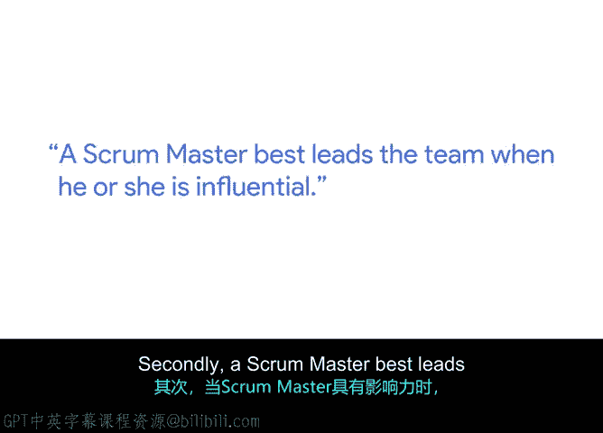

# 谷歌项目管理：专业证书 第5课：《敏捷项目管理课程（Google）》｜agile-project-management｜ - P17：17_02_03_Pete：高效Scrum Master的关键要素.zh_en - GPT中英字幕课程资源 - BV1cF411C7kN

Hi， my name is Pete and I work as a technical program manager in Google。

 The responsibility of the technical program manager is to see the end to end execution of the programs for which they're responsible within the day today。

 we use we use the agile framework。As a core part of our deliveries。

 it allows us to iterate on the process， and it allows us to deliver products to our users much faster than traditional models。

 And the Scrum framework is just a single implementation of the agile methodology。

Scrrum focuses on delivering rapid value to the customers and our users by working iteratively over short periods of time to deliver a product to our customers at its core。

 Scrum is a self organizing team， which means we bring individuals together。

 So it's important that when we bring these individuals together。

 Everyone is clear in the roles and responsibility that they'll lend to this team。

 So it requires that there be a leader or Scrum master who helps to ensure that we're always working towards the same goal。

 What makes an effective scrum master is one that has the following qualities。 First。

 you're a good teacher and communicator。 This is important because you need to instill the scrum values throughout a team。

 Secondly， a scrum master best leads a team when he or she is influential。

In most cases， the Scmaster does not have managerial responsibilities for the rest of the team。

 So it has to be through influence。 and two key ways of doing this is to ensuring that the team is operating effectively。

 And second， ensuring that there's a culture of motivation within the team as a leader。

 you're also expected to give direction to the team and ensure that we're continuing to work towards the goals that we have set out to achieve during the sprint。

 And by sprint， it's a focus effort towards particular welldefined goals。

 and it's like a burst of energy for the team to get us there。

 And I love the aspects of working with people and trying to come towards a common goal。

 It's not always easy， but it's always satisfying for me。😊。

