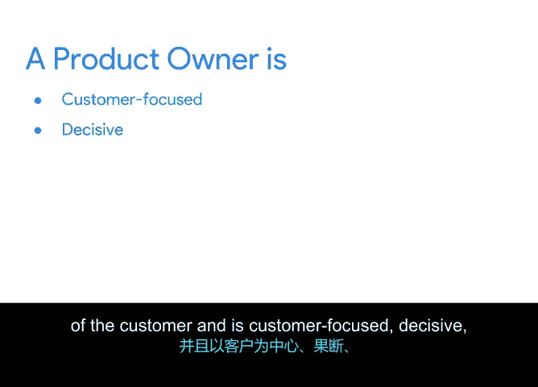
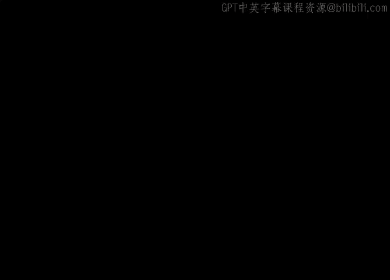

# 谷歌项目管理：专业证书 第5课：《敏捷项目管理课程（Google）》｜agile-project-management｜ - P18：18_02_04_高效产品负责人的特征.zh_en - GPT中英字幕课程资源 - BV1cF411C7kN

Hi again。In the last video， we reviewed the role of the scrubrum masterer。

Now I'm going to give you an understanding of what the product owner does。

You'll also begin to notice how the relationship between the product owner and the development team works。

A product owner is tasked with ensuring that the team is building the right product or service。

An efficient scrum team isn't useful to anyone if they're creating a product that users don't want。

The product owner ensures that the team is building the right thing。

A product owner is responsible for continuously maximizing the value of the product delivered by the Scrum team。

Their key activity is acting as the voice of the customer within the team。

They represent and express this voice through their ownership of the product backlog。

As a quick reminder， the product backlog is the single authoritative source for things that a scrum team works on to achieve the project goal。

 The product owner' responsibilities also include helping the scrum team understand why their work matters within the overall goal in mission。

They also prioritize the product backlog to optimize the delivery of goals and deliver value to customers。

The product owner ensures that the product backlog is visible and transparent to all。 And finally。

 they're responsible for making sure that the product or service fulfills the customer's needs。 Few。

 that's a lot。So how do product owners accomplish all of that？

They rely on their key character traits。A product owner's role requires them to be customer focused。

 so they must understand a customer's needs and the industry of their business extremely well。

Product owners also have to be decisive， great communicators and understand both sides of the issue so they can defend their decisions to the team。

They must be flexible and open to new information that could generate a profitable change for the team。

They also have to be optimistic and positive， especially since they're delivering the product vision to the team。

 and they must inspire the team to believe in their mission。

 product owners also have to be available， the iterative nature of Scrum means that the team needs the product owner to help inspect。

 adapt and plan the next iteration on a regular basis。And finally。

 they must be collaborative product owners will have to work with their team to ensure that the customer's needs are met。

And that will require meeting with and working alongside several stakeholders。

So as you may have noticed， the product owners are responsible for a lot of the project。

 just like the Scrum master。Let's imagine an example of how a product owner will work within virtualt Verde。

For example， let's say that the virtual verde product owner told the development team that they need to work on the following features in this order。

 F arrangements， potted succulents， largege potted plants and herb gardens。

 When the development team reviews the list， they tell the product owner that herb gardens originally sounded difficult to deliver because they're considered regulated food items。

 But in reality， the vendor specialist on the development team knows that herb gardens are actually way easier than we thought。

 because our vendor already has many herb gardens in stock。

So the development team suggests focusing on herb gardens first。

A product owner who is flexible and customer focused will adjust the priorities based on this new information。

So to recap， we discuss that a product owner acts the voice of the customer and is customer focused。

 decisive， flexible， optimistic， available and collaborative。

Next up， we'll discuss the role and traits of the development team。

