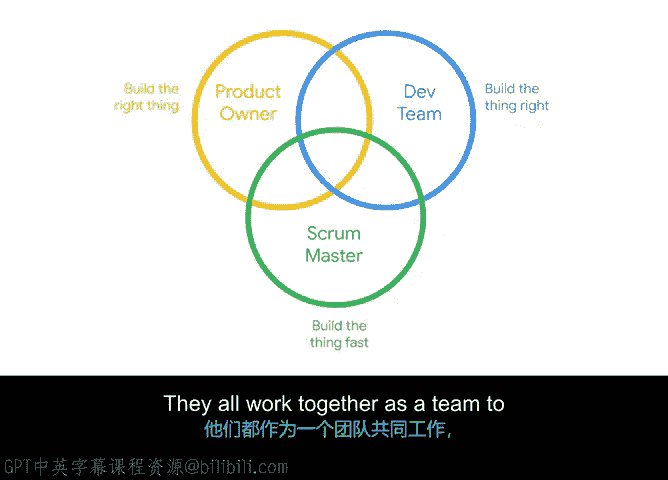

# 谷歌项目管理：专业证书 第5课：《敏捷项目管理课程（Google）》｜agile-project-management｜ - P19：19_02_05_高效开发团队的特征.zh_en - GPT中英字幕课程资源 - BV1cF411C7kN

Hi again。In the previous video， we discussed the role of the product owner on the scrum team。

 In this video， we'll discuss the development team within a scrum team。

 The development team is made up of the people who do the work to build the product。

 The size of the team ranges from 3 to 9 people。This ensures that the team is small enough to remain nimble。

 but large enough to complete significant work within each sprint。

Getting the team sized just right is important smaller teams can struggle with diversity of skills and ideas while larger teams may run into issues where there are too many opinions and streams of communication。

The development team should be cross functional， so they're capable of building the product or service in house since the team has all of the required skills。

The development team also owns their processes and structures。

 so they have to be self organizing and can't rely on others to tell them how to organize。

They continuously operate as a team rather than individuals。

 and they support each other in reaching the team's goals。Lastly。

 the development team acknowledges that the best products emerge from teams who are customer oriented and focus on the user when building their products。

Many scrum teams prefer to be co locatedated， meaning they work alongside each other in the same physical space。

Many believe the team delivers higher quality work and improves faster if they are co located。

But this isn't always possible for every team， let's take a look at an example。

Let's say that the virtual Verde team discovers an issue with one of their plant vendors。

 They can't make the holiday rush due to some product quality issues。

The quality assurance specialist on the team can fly across the country and help the vendor。

 but that means they won't be available to complete their assigned tasks if the team is co-located。

 they can quickly huddle in a conference room and write out some ideas to either get the work done or rearrange the work so this doesn't impact the sprint goals if they don't sit together or work in different time zones。

 this collaboration is a bit harder has to be done over phone or email or you'll have to coordinate the schedules for a meeting and you might have to come up with workarounds that ultimately lead to overall project delays。

On the flip side， we live in a world where working virtually is possible。

 so if the quality assurance specialist needs to be on a call。

 they can dial in or join via video conferencing platform like Zoom or Skype。

Both coloccating and working virtually has its benefits and drawbacks。

 so make sure to use whichever method is best for your team。At this point。

 we've covered each role within a scrum team。A product owner is responsible for meeting customers' needs。

 also known as building the right thing。A development team is responsible for creating the product。

 also known as building the thing Right。The Scrum master is responsible for improving efficiency。

 also known as building the thing fast。We know that each role is vitally important to achieving the goals of a Scrum project。

 no individual is more or less important than the others。

 they all work together as a team to create value for their users and customers。

In the next set of videos， we'll review what you've learned so far。

