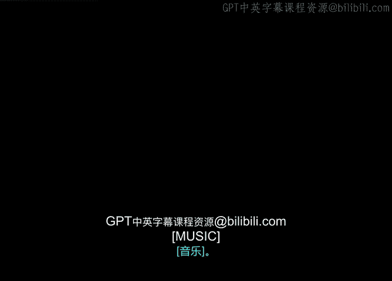
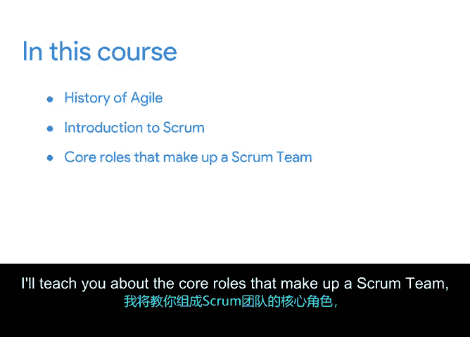

# 谷歌项目管理：专业证书 第5课：《敏捷项目管理课程（Google）》｜agile-project-management｜ - P1：01_01_01_课程简介-5.zh_en - GPT中英字幕课程资源 - BV1cF411C7kN

Hello and welcome to Agile Project Management。So far。

 this program has covered the foundations of project management and what it takes to be a project manager。

We've explored the phases of the project lifecycle， initiation， planning， execution， and closing。

And we've reviewed lots of different tools and techniques for managing and communicating your plans。

We've also discussed how to handle various challenges， risks， and issues that come up along the way。

If you've completed all the courses so far， congratulations， if you're just now joining， welcome。

Either way， you're on your way to a new or maybe just improved career in project management。

 Now that you have a solid foundation on what it takes to manage a project。

 I'm going to share with you one of the most popular approaches to delivering projects。 Agile。

 In my opinion， Agile is also the most interesting and flexible approach to project management。

Agile is not a project management methodology in and of itself。

 but more of an overarching approach and philosophy to deliver value to customers。

 which is the goal of most projects。Despite not being a specific methodology。

 there are lots of frameworks and methods under the Agile umbrella。 In this course。

 I'll help prepare you for a career in agile project management。

 I'll provide you with a history of Agile and introduce you to a specific agile delivery framework called Scrum。

I'll teach you about the core roles that make up a scrum team。

And finally， I'll cover some best practices and real world scenarios where you can use the agile approach to lead your project to success。

 Oh， and I should probably introduce myself。 My name is Sue。

 and I'm a senior technical program manager with Google support platform。😊。

We build the products you use to get user support from nearly all of Google's products。

I started at Google in 2014 and worked on product reliability。

Making sure Google's products are up and running all the time for billions of people across the world who depend on them。

Before Google， I worked at many companies of different types and sizes。

 where I ran and worked on projects using waterfall， agile， and everything in between。

I started my career as a software engineer working on cell phone technology。

 but I didn't have a degree in computer science。 Since then， I've had many different roles。

 but program management is my passion because it brings all of the disciplines together to deliver amazing outcomes for the customers and equally amazing results for the business。

😊，I still remember the aha moment I had when I discovered Agile。

 and I'm excited to share it with you。I hope you're ready to discover Agile and experience your own Aha moment。

In the next video， we'll start learning the basics of Agile， meet you there。

