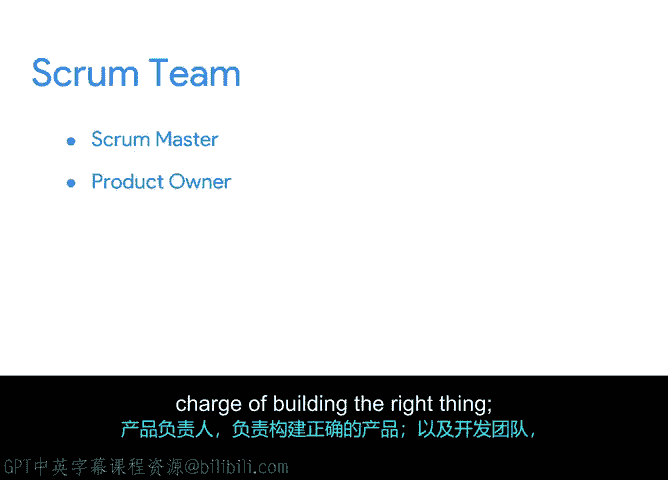

# 谷歌项目管理：专业证书 第5课：《敏捷项目管理课程（Google）》｜agile-project-management｜ - P20：20_02_01_总结_2.zh_en - GPT中英字幕课程资源 - BV1cF411C7kN

Congrats on finishing a new section。You're on your way to becoming a scrum expert。

Throughout these videos， we've extensively reviewed a theory in the Agile framework called Scrum。

As a refresher， scrum is the most common framework that uses a agile approach。

 but there are others like Kanban or Lean， We discussed those approaches in previous videos。

I introduced you to every Scrum team member's source of truth， the Scrum guide。

 which you can always use as a resource。We discussed the Scrum theory which has three pillars。

 transparency， inspection and adaptation， and we explored the five scrum values， commitment， courage。

 focus， openness and respect。We win over the essential roles on a scrum team。

 You may remember that those roles are the scrum master who ensures the team builds the thing fast。

 The product owner who is in charge of building the right thing and the development team。

 whose role is to ensure the team builds the thing， right。

It's quite a feat that you've gotten this far in the program。

 so I hope you're really proud of yourself。I'll meet you in the next section where we'll discuss how to implement Scrumum。

