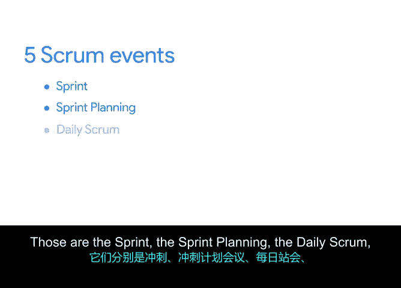

# 谷歌项目管理：专业证书 第5课：《敏捷项目管理课程（Google）》｜agile-project-management｜ - P21：21_03_01_简介-实施Scrum.zh_en - GPT中英字幕课程资源 - BV1cF411C7kN

Hi there， in the previous section we introduced you to Scrum。

We learned about Scrum values and explained the roles that are essential for all Scrum teams。

In this video， we'll complete our overview of Scrum and dive deep into the setup and day to day execution of a Scrum team。

We will go beyond what is provided in the official Scrum guide and share the most popular tools。

 methods， tips and tricks for working with a Scrum team。

I'll discuss how to manage your product backlog， which contains all of the features， requirements。

 and activities associated with deliverables to achieve the goal of the project。

Once we have a backlog， one of the trickiest parts of scrum is estimation。

 we'll learn what Tshirt sizes and story pointss have to do with scrum as we discuss a technique called relative effort estimation。

Next， you'll learn about the five important scrum events。 Those are the sprint， the sprint planning。

 the daily scrum， the sprint review， and finally， the sprint retrospective。

We'll learn what velocity means and how your team can use tools like burndown charts to manage their progress。

I'll show you some other useful tools like Google Docs， JRA， Asana， Trello， Kban boards， and more。

 which will help your workflow stay organized and transparent。

So let's get started we'll begin by discussing the product backlog。

 which is a critical artifact for Scrum teams， meet you in the next video。

