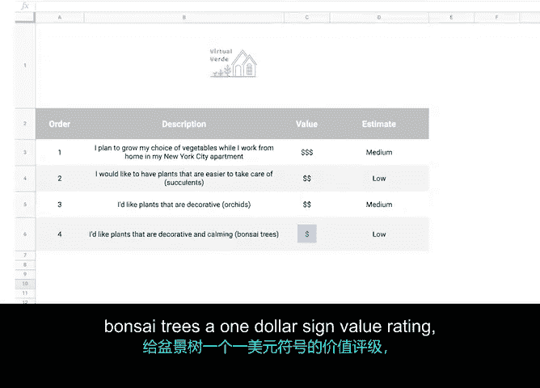

# 谷歌项目管理：专业证书 第5课：《敏捷项目管理课程（Google）》｜agile-project-management｜ - P22：22_03_02_构建产品待办列表.zh_en - GPT中英字幕课程资源 - BV1cF411C7kN

In this program， we've introduced you to lots of project management artifacts such as project plans。

 statements of work， Racy charts， and more。Now， we'll review an important artifact of the scrum framework。

 the product backlog。 In an earlier video， we defined the product backlog as the single authoritative source for things that a team works on。

 It contains all of the features， requirements and activities associated with deliverables to achieve the goal of the project。

The traditional non agile project management equivalent would be the set of project requirements。

There are three key features of a product backlog。 First， the product backlog is a living artifact。

 meaning that items are added to the backlog at any time。

 The product backlog evolves throughout the whole life cycle of the project and serves as a central guide for the team to know what to work on next。

 Second， the product backlog is owned and adjusted by the product owner。 And finally。

 the product backlog is always a prioritized list of features。

 So when there is new information or new features， those are added to the backlog in order of importance。

The items at the very top of the list are very specific and well defined。

 leavingaving the more vague items for the bottom of the list。 Remember。

 the product backlog is the guide and road map of your product。 It's the central artifact in Scrum。

 where all possible ideas， deliverables， features or tasks are captured for the team to work on。

Because the backlog is so central， there are a few best practices and pieces of data to capture when working with product backlogs。

 There's the description， the value， the order and the estimate。

Let's go through how to build a sample backlog with these best practices in mind。 First。

 there's the item description。 The item description is exactly what it sounds like。

 It describes an item。 When you're writing an item description。

 It's a good idea to be really clear when adding product backlog items。

 So the details are encouraged。 For instance， on Office Green's new project。 Vir Verde。

 Here's an example of an item description。 as a virtual Verde client。

 I plan to grow my choice of vegetables while I work from home in my New York City apartment。

 This item description includes essential details such as an action and a location from the perspective of the customer。

😊，This ensures that the development team has enough information to meet the user's needs。Next up。

 we have the value field， this is the field that tells us how much business value the item delivers to the customers。

 to the team or to the users。How to indicate value is a choice the scrum team should make together。

 I like to set value by using dollar signs， ranging from $1 sign for low value all the way up to $4 signs for high added business value。

 Next， we have to add in an estimate。 An estimate is how much effort the scrum team thinks an item will take to complete。

 We'll explore how to do relative effort estimation coming up。 But for now。

 it's important to know that the relative effort estimate is captured in each backlog item。

 This field in the backlog is owned by the development team。

 The next attribute of each backlog item is the order。 As we mentioned。

 the backlog should always be prioritized。 Both the estimate and value fields we just discussed help the product owner figure out where to place an item in the backlog's order of hierarchy。

 A product owner may ask themselves how important is this backlog item compared to all the other items。

 product backlogs order items from highest to lowest priority。 This is called a stacked rank。

Ordering items this way allows teams to operate more efficiently。 For example。

 our virtual Verde market research team learned that people who work from home would much rather have plants that are easy to take care of versus a more high maintenance plant like orchids。

Then the team prioritizes the simple and easy plants on the backlog like succulents higher than the orchids。

 so their product backlog lists one， succulents， two orchids， but say， for example。

 supports an email from a user who says they'd love to have boonsai trees。

 which are also hard to take care of。Where do we put it in the order？

Before orchids or after the product owner does some research and decides that the team will do orchids first because they find that many more users have requested orchids versus Bonsai trees。

 The product owner gives orchids a $ two sign value rating。

 Bonsai trees a $1 sign value rating and puts Bonsai trees last on their list。 Awesome。

 let's move on。 When creating backlog items， The goal is to include as much as you can while not stressing about the unknowns too much。

 For example， the product owner in virtual verde doesn't know yet how much Bonsai trees cost compared to succulents。

 So they don't know if they serve a high end market or a low end market。😊。

They document an assumption in the Bonsai tree description and move on。

 They can study that in more detail when it is higher on the priority list。

So now you know a bit more about defining the product backlog and who owns it。

We also discussed how the various roles work with a product backlog and we can identify and describe each field in a product backlog。

In the next video， we'll learn how to manage the backlog。

 which changes throughout the scrum practices， meet you there。

