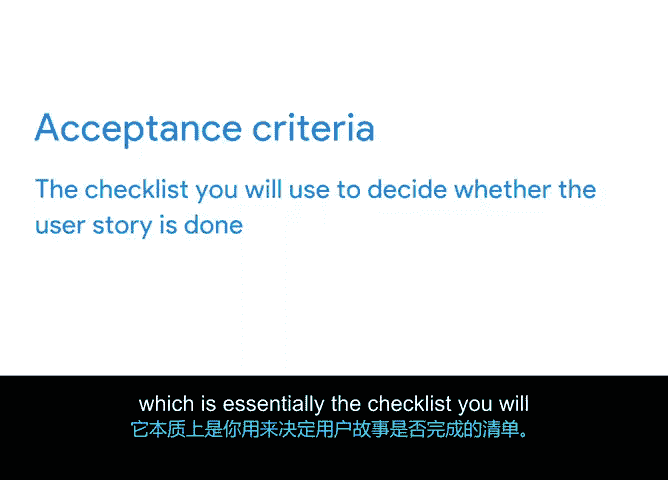

# 谷歌项目管理：专业证书 第5课：《敏捷项目管理课程（Google）》｜agile-project-management｜ - P23：23_03_04_编写用户故事.zh_en - GPT中英字幕课程资源 - BV1cF411C7kN

In the last video， you learned about a product backlog。

We discussed that in order to properly build the backlog。

 the project manager must consider factors like descriptions， value， order， and estimations。

This ensures that you， as the project manager， will include enough information to meet the product owner's vision for user value。

 Now that you know about the various fields associated with each item in your backlog。

 let's discuss a popular way to capture and manage those backlog items。 Use stories。

 Use stories are short， simple descriptions of a feature told from the perspective of the user。

This helps the team create a solution that's always centered around the user and the user experience。

User stories might start off large and broad or may be broken down to be as small or specific as possible。

In this lesson， we're going to give you some ideas on how to write user stories and how to break them down。

User stories are made up of three different elements， the user， the action they will take。

 and the benefit to them。These elements might have a few different formats。

 but the most common is as a user role， I want this action so that I can get this value。

When writing effective user stories， the team must have a user in mind。

 imagine that the user will interact with the product in order to achieve a specific outcome。

What I really like to do at this stage is create personas or detailed descriptions of my different users。

 Sometimes I even give them names。So in virtualt Ver Day。

 we could give our users some names and some information about them。Here are some user persona ideas。

 Leo is my plant vendor who manages acquiring the plants， the supply chain and delivery logistics。

 Felicity is my gardening expert who helps my support team give our customers really excellent advice on how to take care of their plants。

😊，Zach is my amateur vegetable gardener who wants to use the plants they purchase to make dinner Na is my management consultant who works from home and wants to set up a professional backdrop for video conferences in their home office。

Rina is my flower aicicionado， who wants to have a different flower arrangement each week to brighten up their home。

By giving these users a name and a backstory， we can imagine them in our minds and we will design better products for them as a result。

I really enjoy writing user stories because it puts me in the shoes of my users。

 Each user story should meet six different criteria represented by the acronym， I N， V， E， S T。

 or In。😊，I， for independentdepend， the story should be able to be started and finished by itself。

It's not dependent on another story to finish it。The N stands for Negotiable。

 there's room for negotiation and discussion about this item。 The V is for valuable。

 This means that completing the user story has to deliver value。E is forestimable。

 our definition of done must be clear so that the team can give each user story an estimate。

The S is for small。 Each user story needs to be able to fit within a planned sprint。

 If that user story is too big， it should be broken down into smaller stories。

 Sties that are low priority on the backlog can stay big until they become a priority for an upcoming sprint。

And finally， the T is testable， a test can be written to check and make sure that it meets the acceptance criteria。

While the product owner is the main person responsible for writing user stories。

 the team has a responsibility to give feedback on whether the user story is clear and fits the invest criteria before they invest any time into it。

 in addition to user stories， you need to know the term E。

 which simply represents a group or collection of user stories。

Some epics for virtual verde might be live plant delivery， office plant advice service。

 vendor management or client data management。 Let's come up with a sample user story for our virtual verde clients in the live plant delivery E as a virtual verde client。

 I would like to acquire a Bonsai tree so that I can have a beautiful plant and I can meditate as I trim the branches。

I thought of this one because I bought a Bonsai tree for my 12 year old nephew last year。

 And he did some research and learned that in Japan， pruning Bonsai trees is a meditative practice。

 So he's learning how to do that。 With that sample user story。

 The product owner creates something called the acceptance criteria。

 which is essentially the checklist。 you will use to decide whether the user story is done。😊。

To have a completed user story， you must meet the acceptance criteria checklist。

Here's an example of acceptance criteria for the Bonsai tree user story user can browse for three different types of Bonsai trees to purchase。

 compare the three trees to know which is easiest and hardest to grow in their home。

 maybe each plant has a beginner， intermediate and advanced gardener notation next to it。

Can purchase specific boonsai tree care packages like fertilizer， trimming shears， etc ce。

Access online to a Bonsai booklet sheet， as well as having a care booklet packaged with the tree。

Can find a troubleshooting Bonsai T tree issues page on virtual Verde's FAQ page。

Sounds like an amazing story， doesn't it， It feels like a real thing that a user can interact with and get excited about。

😊，Each user story in the backlog should be written this way。

It's natural for items higher in the priority list to have more detail and fewer gray areas。

By leaving these low priority items vague， this saves the team time from working on items that may end up getting deprioritized down the road。

Fantastic now you know how to explain user stories。

 the criteria for assessing user St readiness for the team。

 and you can explain Es and user story acceptance criteria。In the next video。

 we'll discuss backlog refinement and explain relative effort estimation。

 T shirt sizes and story points， meet you there。