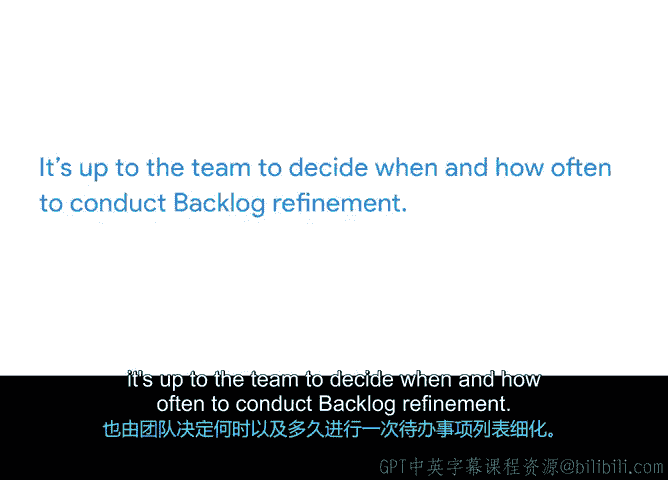

# 谷歌项目管理：专业证书 第5课：《敏捷项目管理课程（Google）》｜agile-project-management｜ - P24：24_03_07_待办列表精化与工作量估算.zh_en - GPT中英字幕课程资源 - BV1cF411C7kN

Welcome back。We've been exploring everything there is to know about a product backlog。

Although the product owner owns or is in charge of the data in the backlog。

 the team must work together to keep the living document up to date。In this video。

 we'll discuss how to do that through a process called backlog refinement backlog refinement refers to the act of keeping the backlog described。

 estimated and prioritized so that the Scrum team can operate effectively。

After the product owner has added the backlog items with a description and a value statement。

 they do backlog refinement。Backlog refinement is when the product owner and some or all of the scrum team review the backlog to ensure it contains the appropriate items and that nothing new is needed or nothing needs to be removed。

 that the items are prioritized by the product owner， this is also called setting the order field。

That the items at the top of the backlog are ready for delivery with clear acceptance criteria。

 and that the backlog items include estimates or an informed assessment about how much work a particular backlog item will be。

Let's discuss estimates since they're crucial in backlog refinement。

 we add estimates to backlog items to inform our planning practices about how much effort it will be to finish each item or user story through estimation we can find out how much work we have ahead of us。

It can be difficult to estimate the amount of time it takes to complete a task more often than not。

 we human beings tend to underestimate the time until completion when it comes to big projects。

 this effect can be multiplied many times and can be the root cause of projects being late and over budget。

So in scrum， we try to overcome this problem by practicing relative estimation instead of absolute estimation。

 absolute estimation is also called time and effort estimation in traditional project management。

 relativeative estimation means that instead of trying to determine exactly how long a task will take。

 We compare the effort of that task to the effort for another task， and that becomes the estimate。

 That estimation is not done in traditional units of hours， days or weeks。 Instead。

 we assign each backlog item of value that is a relative unit for size。

 There are two common relative estimation methods that I find most useful when estimating user stories。

 These are t-shirt sizes and story points。 Let's start with the simpler of the two T-shirt sizes。😊。

To get started， the team simply picks one item on the backlog that seems to be about a medium size workload and simply calls that a medium in the estimate field。

 After that， they take another item on the backlog and compare it to the medium item they just identified and answer the question if that first item was a medium。

 what size would I give this one。The team will repeat this process on each additional item or user story on the backlog until they're all addressed and done。

 For example， let's take four items from Virt Verde's product backlog。

Adding Bonsai trees to the catalog， creating a mobile app， launching a new logo。

 creating the new account page。 The team decides that launching a new logo is their medium。

The team together compares the other three items to that medium item。

 which gives them their relative effort estimate。Then there's my favorite method for estimating user stories。

 tasks and backlog items known as story points。 St pointss are a bit more advanced than t-shirt sizes。

 but the concept is similar。 The first step is the same。 The team picks an item as their anchor item。

 and they'll conduct their estimations relative to that item。Instead of using T shirt sizes。

 this process uses what are called story pointss。Most teams use a famous mathematical sequence of numbers called the Fibonacci sequence。

 the Fibonacci sequence is 01，1，2，3，5，8，13，21， and continues on to infinity。

For the sake of story pointss， we skip zero and the first one These numbers are special in that they start out close to one another。

 but as the numbers get higher， they spread farther and farther out。

This is helpful because as the estimate gets higher， the uncertainty and risk also gets higher。

This number combines both effort and risk into one number。In other words。

 there is not much use in debating estimation values between 21 and 25 points。

 but choosing between 21 and 34 is a real conversation。 This concept can be tricky at first。

 and practice is the best way to learn it To explain this concept in the classes that I teach at Google。

 we use this example。Let's say you want to measure the effort to completely consume different kinds of fruit。

You have in front of you an orange， a strawberry， a banana， a mango， a pineapple， and a cherry。

 What are the factors that go into that estimate are there seeds to deal with。

 Do I need to eat it with a napkin， Can I eat it in one bite。

 Do I have to peel it or do I need any tools to prepare it。Okay， let's try it。

If I choose a mango as our starting fruit at five points， how might you estimate the rest？

I would rate them this way。 Orange 3， because the peel is easier than cutting a mango。Strawberry one。

 because I don't mind eating stems， low effort。Banana three。

 because I have to peel it similar to oranges。Pineapple13， it's giant。

 I can't eat it in one sitting and cherry， two， stems， seeds， you know what I mean？

It's really fun to learn how differently people have learned how to cut up a pineapple。

But more importantly， what estimation exercises do for a team is uncover great ideas on how to get something done。

 as well as surfacing where the riskiest parts of the project are。

Why do I like story pointss better than T shirt sizes， let's apply them to our virtual Verde backlog。

Now， we can see that adding a new user and adding Bonsai trees to our catalog aren't quite the same size。

 which the T shirt sizes might have implied。Using story pointss。

 a new user is8 points and the Bonsai treeses are 13 Why would I mark them this way Well。

 implementing a new user page is a simple software update。

 adding Bonsai treeses is more than just software， it includes finding vendors building a supply chain and more。

I mentioned earlier that backlog refinement， which includes adding estimates and updating the order field。

 should take place regularly。Just as it's up to the team to choose which estimation method they select。

 it's up to the team to decide when and how often to conduct backlog refinement。

Some teams prefer to set up special meetings just to refine the backlog。

Others will simply refine the backlog continuously in conversations or emails。And finally。

 some teams will conduct backlog refinement as part of a scheduled event like their sprint planning meeting now you know how to define backlog refinement and you can explain relative effort estimation T-shirt sizes and story points in the next video we're going to learn more about sprint planning meet you there。

