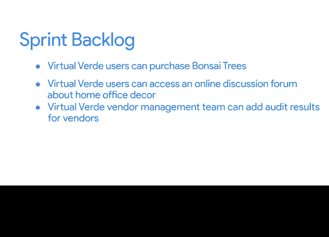

# 谷歌项目管理：专业证书 第5课：《敏捷项目管理课程（Google）》｜agile-project-management｜ - P26：26_03_03_Sprint计划会议.zh_en - GPT中英字幕课程资源 - BV1cF411C7kN

Hi again。In the last video， we discussed the parameters for a sprint。

 We learned that a sprint is one of five scrum events and creates the frame around all other scrum events。

 Next up is sprint planning。 The first event within the sprint that sets your team up for success for the next one to four weeks depending on the length you chose。

 for sprint planning。 The entire scrum team comes together and meets to confirm how much capacity。

 meaning time and people are available during this sprint。

 and then they identify what items from the backlog will be done during the sprint。

 This becomes the sprint backlog， and ultimately the sprint goal。

 This is a time for the scrum master to facilitate team communication and answer the following questions throughout the event。

 Who is available during this sprint。😊，Are there any vacations or conflicts that we should know about？

What has been our average velocity， meaning how many points or backlog items have we been able to complete in a single sprint in the past？

What can and should be accomplished by the team in this upcoming sprint？

What is the ultimate sprint goal？How will the work get done？Throughout the sprint。

 who is responsible for what tasks we've discussed sprint lengths and story sizes。

 So let's explore the meaning of definition of done。

Definition of done refers to an agreed upon set of items that must be completed before a user story or backlog item can be considered complete。

 Some things that may be within your definition of done are the code or solution itself is reviewed by an independent peer group。

 The product or unit passes。 All testing requirements。

 which could include security or performance testing， documentation is completed。

All user story acceptance criteria specified by the product owner is met。 and finally。

 the product owner accepts the user story。This list isn't comprehensive。

 and the team should determine what should be on this list and improve it as needed。

A key deliverable of the sprint planning event is the sprint backlog。

The sprint backlog is the set of product backlog items that are identified for completion during the upcoming sprint。

 In other words， the sprint backlog is a subset of items from the product backlog that you'll aim to finish during that particular sprint。

 For example， Vi Verde's product backlog might have 50 backlog items。

 And Vi Verde has created four weekek sprints that are named by month。 May sprint， June sprint。

 July sprint and so on。 for the May sprint。 The team has determined that they can complete the top five of those items based on the capacity of the team for May and the size of the effort of those items。

Those five items now make up the sprint backlog。 The sprint goal is the overarching objective that the team aims to achieve and helps the team understand the why of the sprint。

This should be taken from a big picture view of the items on the sprint backlog。

The benefit of having a bigger sprint goal identified is that it helps the team focus on a broader team objective。

 rather than putting them into separate work streams。For example。

 let's say Vir Verde has identified these five items as the sprint backlog for May。

Virtual Verde users can purchase Bonsai trees。 Virtual Verde users can access an online discussion forum about home office decor。

 Virtual Verde vendor management team can add audit results for vendors。

Virtual Verde users can use a coupon to purchase home office accessories。

 Virtual Verde customer support can connect products to support tickets。

 So the sprint goal is to provide a comprehensive experience to the user who wishes to install a Bonsai tree in their home office。

😊。

All of these backlog items can be connected to this sprint goal in some way。 For example。

 there is a new coupon for Bonsais。 The vendors are audited for Bonsai tree quality and so on。

To recap， we just learned that sprint planning will result in a well defined and estimated sprint backlog。

 as well as a sprint goal to keep the team motivated towards that final achievement。

See you in the next video where we'll cover more sprint events。

