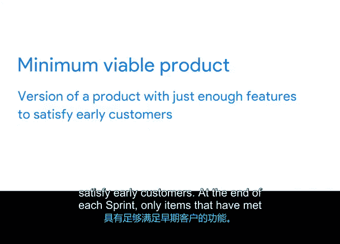

# 谷歌项目管理：专业证书 第5课：《敏捷项目管理课程（Google）》｜agile-project-management｜ - P27：27_03_05_每日站会与Sprint评审会议.zh_en - GPT中英字幕课程资源 - BV1cF411C7kN

As a refresher， one of the principles from the Agile Mano states。

The most efficient and effective method of conveying information to and within a development team is face to face conversation。

So in this video， we'll discuss communicating with the team through two kinds of face to face events that occurred during and after the sprint。

 the daily Scrum and the sprint review。First， the daily Scrum。

 which is sometimes referred to as standup， is a time for the scrum team to synchronize and prioritize activities for the day。

In 15 minutes and at the same time and place every day。

 each team member answers the following questions， what did I do yesterday that helped the development team meet the sprint goal？

What will I do today to help the development team meet the sprint goal？

Do I notice any impediment that prevents me or the development team from meeting our goals？

Daily standups should provide the scrum master with the opportunity to quickly unblock the team with little delay。

 and daily standups are an opportunity to reinforce focus on the sprint backlog and sprint goal。

 The official scrum guide says that daily standups must happen every single day。

 though I will say I have had successful scrum teams who meet less frequently than that。😊。

My current scrum team has a one week sprint， and we have stand ups two days during the week。

 We found that this works really well for us。Try it out and see what works best for your team。

At the closing of a sprint， the team will complete another event known as the Sprint review。

This sprint event is crucial to the scrum pillars of inspection and adaptation and demonstrate the values of openness。

 courage and respect。 Let's discuss what I mean by that。

The Sprint review is a meeting with the entire Scrum team where the product is demonstrated in order to determine which aspects are finished and which aren't。

During a sprint review， the development team and product owner will play a heavy role in this inspection and discussion。

They'll also cover an exploration of which items should be considered done in the product backlog。

And they'll demonstrate and inspect the product。Sprint reviews should be really fun and uplifting the sprint review is when the team gets to impress each other with the cool things they've accomplished over the last one to four weeks。

These time boxed meetings should not exceed four hours。

 and theyre a good opportunity for the team to practice the scrum values of openness and respect as they give feedback about the completed work。

Often， some of the greatest product ideas come out of the sprint review。Let's look at an example。

 with the new service， the virtual Verde team needs to launch their new website page featuring home office plans。

Let's imagine that the Scrum team has a marketing specialist on the team， remember。

 scrum teams are cross functional。During the August Sprint review meeting。

 one of the sprint backlog items was to create a launch email to send out to their existing plantt Pell's corporate customers about their brand new adventure。

During the sprint review meeting， the team gets a demo of the email。

 they pull up the email onto the shared screen and give the specialist feedback right there in the meeting。

 such asLo that opening line really draws them in。Let's make the opening image bigger。

 Can we make it easier for the recipient to forward this to their friends。

 Can we make this text shorter， It's a bit long。This group inspection of a work product from the team has many benefits that go way beyond just a better marketing email。

First， it makes the feedback as immediate as possible。

 no need to wait for people to review on their own and send in their feedback later on。

Feedback and adjustments might be made right there in the meeting。Second。

 everyone has a voice leading to a shared sense of ownership of every aspect of their product launch。

Last but not least， the team learns more about how their marketing teammate does their job。

Leading to greater trust and understanding between team members。

The sprint review is a time for the team to demonstrate what they've accomplished。

 The sprint review is also where team members unveil what is called the product increment。

The product increment is what's produced after a given sprint and is considered releasable。

 a product is releasable when the team has developed a minimum viable product。

 which has a set of implemented features or requirements。

A minimum viable product is a version of a product with just enough features to satisfy early customers。

At the end of each sprint， only items that have met the definition of done are considered part of the product increment。

Anything that is not done goes back to the product backlog。Great work。

 We've now covered the activities that happen during a sprint to ensure that the team is focused and is building valuable solutions。

In the next video， we'll discuss another important meeting that takes place on a Scrum team。

 the Sprint retrospectivetro， meet you there。

