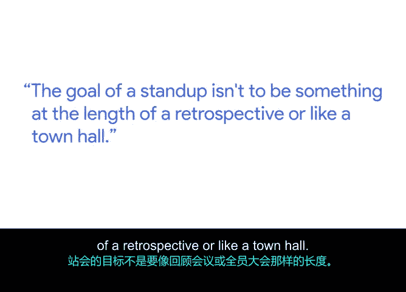

# 谷歌项目管理：专业证书 第5课：《敏捷项目管理课程（Google）》｜agile-project-management｜ - P28：28_03_06_Sarah：每日站会的益处.zh_en - GPT中英字幕课程资源 - BV1cF411C7kN

Hi， I'm Sarah， and I'm a program manager on the engineering education team at Google。

 One way that I go about centralizing and organizing that I think is not spoken about as regularly as documentation is honestly just having a daily standup or a weekly standup with your crossfunction project team。

 Sometimes as the project manager， you're inclined to just be like， oh， well。

 like our data analyst might not need to know what our marketer is doing just because they're so separate。

 but honestly giving everybody the opportunity to come into a meeting week over week and just talk through very quickly。

 This is what I just finished， this is what I'm working on。 creates a certain amount of visibility。

 transparency and like creates a sense of camaraderie and teamwork in a way that just documenting all of that without having a conversation about it doesn't really solve for。

 the goal of a stand up isn't to be something at the length of a retrospective or like a town hall。

These are meant to be as short as possible， I usually schedule them for 15 or 20 minutes and I'm happy if it's shorter。

 we really want people to just quickly get through what they're working on right now and if they have any blockers。

 anything that might be getting in the way for a particular teammate or project part of the project in making progress。

 then you might need to set up additional time with that particular person or work stream owner to work through those tasks and see what you can do to help unstick them。

Another thing to think about with a daily standup is that you're likely going to be working with people across a lot of different time zones。

 a lot of different locations。 I recommend sending out like a gut check or survey to be like are we going to be okay with doing 11 AMT are we going be okay with doing4 PMET and then kind of sticking with it to make sure that it feels like it's a consensus before you just put it on calendar and expect everybody to show up every single time if you're working on like a project with a very tight deadline if you're doing a standup every single day I try not to create a culture where it's mandatory that everybody's there it's happening every day and there might be some components of a project that are moving quicker at other times than others a great way to keep people within their time box and within a daily standup or any type of meeting is to before the meeting create an agenda and actually write out next to it how many minutes you're hoping to allocate to whatever update it is But if something comes up I generally try to say like don't you know cut them off midsentence。

N， it's never a nice way to work with your with your stakeholders or with your project team to just be like two minutes are up。

 you're done， but just say at some point when there's a natural break in conversation that hey。

 we actually needed to give this other thing another 10 to 15 minutes so can we put a pin in that and come back to it if we have time later and if not in the next meeting。

