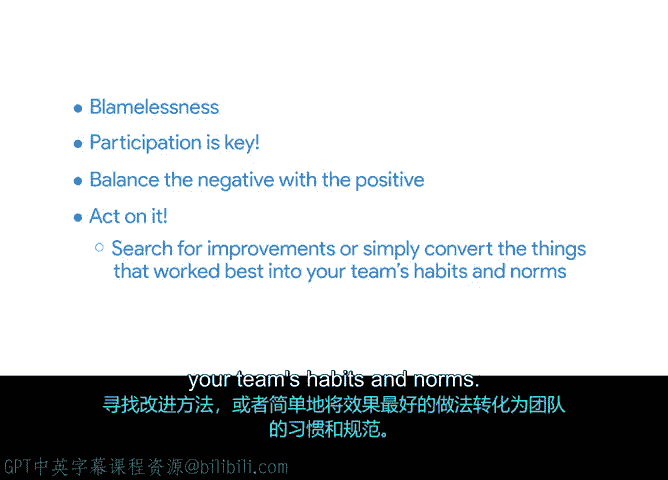

# 谷歌项目管理：专业证书 第5课：《敏捷项目管理课程（Google）》｜agile-project-management｜ - P29：29_03_08_Sprint回顾会议.zh_en - GPT中英字幕课程资源 - BV1cF411C7kN

If you've been following this program， you've learned a lot about retrospectives。

 an important part of project management， regardless of the approach you're taking。In this video。

 we'll cover the last of the five events of Scrum， the sprint retrospective。

The sprint retrospective is an essential meeting of up to three hours for the Scrum team to take a step back。

 reflect， and identify improvements about how to work together as a team。In a sprint retrospective。

 the Scrum team will reflect on what's working or not working for the team regarding the people。

 the processes， and the tools。What improvements are worth exploring in the next sprint？

And what improvements were put in place for the last sprint， were they helpful or not， and why？

In my experience， there are some key measures to take to ensure sprint retrospectives are a success。

First， it's important to demonstrate the scrum value of respect and always allow the team to remain blameless。

If any team member is worried there may be negative consequences for providing feedback。

 your outcome won't be as beneficial。 You'll need to create a safe space for candor by acknowledging potential awkwardness and if needed。

 create a space for anonymous or private feedback。Participation is key because retrospectives only work if participants feel like their input matters。

If you notice folks aren't volunteering their perspectives。

 search for ways to generate new ideas such as asking them what is one thing we could try in the next sprint。

 what slowed us down？What happened that we didn't expect？

The answers to these questions can help you understand how to improve For example， just recently。

 my team discovered that having dependencies on stakeholders outside of our scrum team was slowing us down。

In our retrospective， we decided to increase awareness of our priorities with these external stakeholders through some new communication channels。

Next， balance the negative with the positive， don't just ask where you can improve。

 but also ask things like where did we notice success。

 you want your team to feel like they were successful and you also want to recreate these successful outcomes。

And finally， make sure to act on it， teams can get discouraged from participating in future retrospectives if it feels like their feedback won't inspire change。

Search for improvements or simply convert the things that worked best into your team's habits and norms。

Facilitating conversation among the Scrum team， both during retrospectives and in everyday workflows。

 is an incredibly important aspect of being the scrum master and a project manager。In the next video。

 we'll discuss how to remain transparent with your workflow through the use of essential scrum tools。

 these will also help facilitate good communication within the team， meet you there。

