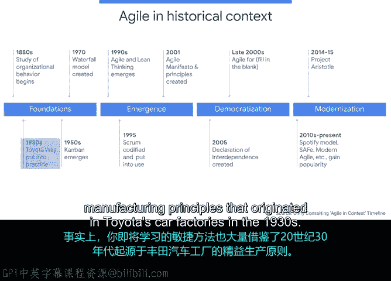

# 谷歌项目管理：专业证书 第5课：《敏捷项目管理课程（Google）》｜agile-project-management｜ - P2：02_01_01_敏捷简史.zh_en - GPT中英字幕课程资源 - BV1cF411C7kN

Hi again。You may remember earlier courses in this program that provided an introduction to waterfall and Agile project management methodologies Now we're going to get more in depth and really expand your understanding of these popular approaches in this video I'm going to give you a brief history of Agile and introduce you to the Agile values and principles and you'll learn that Agile can be and is used in lots of different industries ready let's get started。

To quickly review， Waterfall is a popular project management methodology that refers to the sequential or linear ordering of phases。

 You complete one phase at a time， not proceeding to the next until it is done。

Then you move down the line like a waterfall， starting at the top of a mountain and traveling to the bottom。

The term agile refers to being able to move quickly and easily。

 It also refers to flexibility and the willingness and ability to change and adapt。

Projects that adopt Agile project management take an iterative approach。

 which means the project processes are repeated often many times during the life cycle of the project。

In this case， the team operates within many shorter blocks of time， called iterations。

Individual iterations might get repeated depending on the feedback received。During each iteration。

 the team takes a subset of all the project's activities and does all the work required to complete that subset of activities。

You can think of it as a lot of mini waterfalls for each activity。

This iterative approach enables the project to move quickly。

 as well as making it much more adaptive to change。 So the term agile means flexibility。

 repetition and openness to change。 But what do we mean by agile project management。😊。

Agile project management is an approach to project and team management based on the Agile manifesto。

The manifesto is a collection of four values and 12 principles that define the mindset that all agile teams should strive for。

So in very basic terms， waterfall is linear and sequential and does not encourage changing up the process once it is started。

Agile， on the other hand， is iterative， flexible， and incorporates necessary changes throughout the process。

Now， a bit of a history lesson， so you can have a better sense of how and why Agile has become such a popular approach to project management。

Agile methodologies emerged organically during the 1990s as the software industry was booming。

 software startups like Google were blazing a trail to get more software products built in less time。

Meanwhile， the tech giants of the time were experimenting with faster ways to build better software and stay competitive。

And by the way， software isn't just the apps and websites that we all use every day。

 Software also includes the code behind innovations in agriculture， medical devices。

 manufacturing and more。 So in this competitive growing environment。

 companies couldn't just create new innovative products。

 they also needed to innovate the very processes they were using to develop those new products。

In 2001， the thought leaders and creators of some of these new processes also called methodologies。

 came together to find common ground between their methods and solve a problem。

The problem they agreed was that companies were so focused on planning and documenting their project that they lost sight of what really mattered。

 pleasing their customers。So these leaders came up with the Agile manifestto to guide others on what they believed really matters when developing software。

 which is keeping the process flexible and focusing on people。

 both the team and the users over the end products or deliverables。Now。

 here's where Agile gets even more interesting。 You can still use Agile。

 even if you're not planning to work on software projects。

 Agile has been so successful in the software industry that its values。

 principles and frameworks have been applied to nearly every industry。 In fact。

 the agile methods that you're going to learn also draw heavily on lean manufacturing principles that originated in Toyota's car factories in the 1930s。

You'll also find agile methods being adopted in the aeronautical， healthcare， education。

 finance industries， and even more。Cool， right， Agile is everywhere。

Now you know a little bit about the history of Agile， the origin of the Agile manifestesto。

 and some of the industries that use Agile for project management。Coming up next。

 we'll compare more of the differences between waterfall and Agile to really familiarize yourself with these project management styles。

