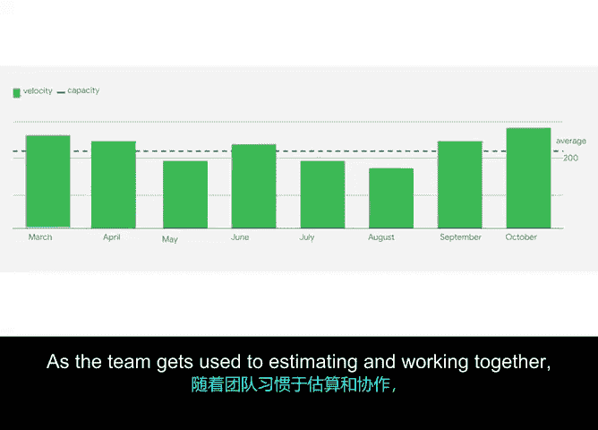

# 谷歌项目管理：专业证书 第5课：《敏捷项目管理课程（Google）》｜agile-project-management｜ - P30：30_03_01_速度与燃尽图.zh_en - GPT中英字幕课程资源 - BV1cF411C7kN

In this video， we'll explore two very important concepts that allow a Scrum team to manage their work as they progress through a sprint and the entire product backlog。

These two concepts are burn down charts and velocity Let's start with what a burn down chart's purpose and how a scrum team uses it。

A burn down chart measures time against the amount of work done and the amount of work remaining。

The goal of using a burn down chart is to keep the team aware of how they're doing against their overall goals。

In a scrum team， burn down charts reflect how the team is doing with completing user stories during the sprint。

The scrum master will review the burn down chart sometimes daily to examine if the team will hit their goals or not。

And there's some simple math and numbers here， so now is a good time to mention what to do if your team is using T shirt sizes rather than story points。

In that case， simply map the sizes to a number and use that number for the burn down and velocity calculations。

 For example， maybe an extra small is one point， a small is two points， a medium is 5。

 a large as8 and so on。Here's an example。Let's imagine our virtual Verde team sprints are four weeks long。

 which will count as 20 business days。In their July sprint。

 the sprint backlog had stories that added up to a total of 200 points to be completed。

If you assumed an even burn of points over the business days。

 you'd expect 10 points to be burned each day。By day five in their sprint。

 22 points had been burned or completed。H，Okay， it's only 25% of their sprint。

 so maybe things are on track。By day 10， 45 points had been completed。 u oh。

 we should have been approximately halfway done by now， which would be100 points。

According to the burn down chart， we're running late according to our sprint goal。Now。

 this isn't the time to panic and stress out the team。 At this point， as Scrum master。

 you should already be discussing with your team to find out how you can help and unblock them。

 By day 15， the burndown is a hundred and 40 points。 Few。 The team is back to humming along。

 by day 20。 The burndown is  a and 88 points completed。 Great job。

 Let's discuss what happened in the retrospective。In Scrum。

 there's a term for how many points a team burns down in a sprint on average。 That term is velocity。

 In other words， velocity is a measure of how many points a team burns down during a single sprint On average。

 When the team is conducting sprint planning， They are using their average velocity over at least three sprints to determine how many items they can safely add to their sprint backlog。

There are a few things worth noting when it comes to calculating velocity。First。

 there is no such thing as a good velocity or bad velocity。

 Veity is simply what the team has historically been able to achieve in a predetermined time box。

The next thing is that each team will have a different velocity。

 especially since each team decides their own point system calibration。

It's impossible to compare your team's velocity to another team'。For example。

 I'm currently on a team of three people， and we're burning down 70 points in a one week sprint。

 so our velocity is 70。But on a previous five person team。

 our velocity for a two week sprint was only 120 points， was one team better or worse than the other。

 nope， just different。Once you have a stable velocity and a refined backlog with prioritization and estimates。

 this unlocks an incredibly valuable superpower。 You can now tell your stakeholders and sponsors two important things。

😊，You can tell them approximately how long it will take to complete the entire product backlog。

And how much of your backlog will be completed by a particular time。

This ability to confidently predict when things can get done is one of the most powerful tools in agileent scrum。

 in my opinion。Let's imagine that our virtual Verde team has averaged 200 points in each monthly sprint for the last three months。

The team knows they have 1，500 points left in their product backlog。

They now can say that it will take them approximately seven or eight sprints to complete the entire product backlog。

What if it's July and the team wants to know what will be available by January 1。 No problem。

 That's five months away。 Just go down the backlog from the top and draw a line when you hit 1000 points。

 That's pretty confident estimate based on the past performance of the team。 Pretty powerful， right。

If you want to pull in the dates， you can use this information to decide to add people to the team and increase velocity。

 rearrange the priorities or make other key project decisions on any given team。

 it can take multiple sprints to reach a stable velocity and that's perfectly normal as the team gets used to estimating and working together。

 the velocity should begin to stabilize。

Now you know how to define velocity， velocity trends， and burn down charts。

 you also learned a bit about how an agile team reaches a stable velocity and what that entails。

Using these tools is essential to any high performing scrum team。

There are powerful means to achieve execution predictability。

I'll demonstrate another useful visualization tool in the next video， meetet me there。

