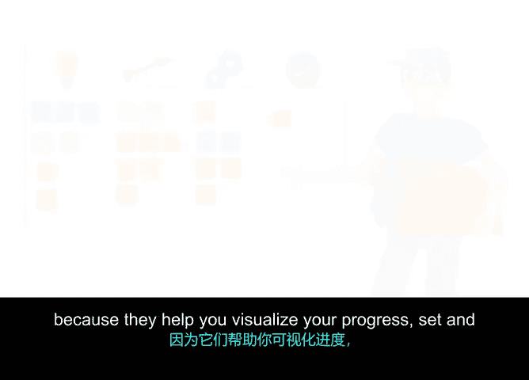

# 谷歌项目管理：专业证书 第5课：《敏捷项目管理课程（Google）》｜agile-project-management｜ - P31：31_03_03_使用看板.zh_en - GPT中英字幕课程资源 - BV1cF411C7kN

We learned about the importance of visualizing progress using burn down charts in the last video。

 And good news。 there are other visual tools that can also help a team progress throughout their sprint。

😊，The tool we cover in this video may be familiar to you since we briefly covered it in a previous video。

 It's the Kban board。 Some teams refer to this as the scrum board rather than the Kban board。

 While the two do have minor differences， they're referring to the same basic tool。

The Scrum guide doesn't specify exactly what a scrum board is。

 but some scrum tools available in the market provide a board that adds some features to a conban board。

These features make it suitable specifically for scrum。

Both boards have three main features that make it a great sprint tracking tool for Scrum teams。

There's visualization， work in progress limits， also known as W limitss， and flow of work。

Visualization can be an important strategy for learning and tracking。

This Kban board communicates everything we need to know at a glance。

 We can point at specific work items on the board we want to discuss。

 Use images with variation and colors and sizes as we check in on work items。

 and we can notice where the challenges are in our team。Without this visualization。

 it's not as easy to find out where we can make improvements。

These boards make it easy to notice where W limits break。

 We learned earlier in this course that Kban whip limits are constraints on how many work items the team actively works on at any given time。

This provides focus for the team， which is one of our scrum values。

Have you heard the idea that there's no such thing as multitasking in scrum， it can be very true。

 And the more work you have， the less efficient you can become。When you use a conban or scrum board。

 each team may set a whip limit based on their configuration and context。 This way。

 it's really obvious to notice when the team is going beyond the whip limit。And finally。

 using a Kban board can give you a better sense of the flow of work through the team's execution processes。

Physical postit notes or even virtual versions of Kban or scrum boards allows the team to experience the movement of work from one phase to another。

Using a conban or scrum board， the team will move the items through the following stages to do。

 doing， and done。This action often takes place during the daily scrum。

 but the team can move items at any time。For example， with our virtual Verde team。

 let's say that Leo， our plant vendor， has finished the item to finalize contracts with the three top plant vendors we plan to use for our initial launch。

Leo will go to the Con board and move his item from doing to done and find out what's next to work on。

If， for some reason， that was the last thing for him in this sprint。

 he may reach out to his team to see where he can help a teammate with their work。So to recap。

 Kban and scrum boards are really useful because they help you visualize your progress。

 set and maintain your team's workload and whip limits。

 and give you a sense of the flow of work throughout the team's execution process。

Awesome， I'll see you in the next video where we'll review a few software products that help a scrum team manage all of this information。

