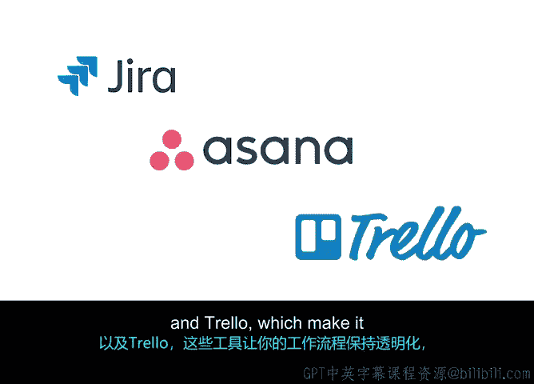

# 谷歌项目管理：专业证书 第5课：《敏捷项目管理课程（Google）》｜agile-project-management｜ - P33：33_03_01_总结_3.zh_en - GPT中英字幕课程资源 - BV1cF411C7kN

Congrats on finishing another set of videos。 I hope you're feeling as excited about scrum and agile as I do every day。

😊，We spent a lot of time covering one of the most important parts of Scrum， the product backlog。

We learned about refining the backlog and the importance of relative effort estimation using methods like t shirt sizes and story points。

 We identified the five important scrum events， which are the sprint itself， sprint planning。

 the daily scrum， the sprint review and the sprint retrospective。

And we learned about when each of these take place and what their purposes entail。

We discussed visual learning by using tools like burndown charts and Com boards。

 we also explored tools like Jra， Asana and Trello。

 which make it easy to keep your workflow transparent and keep every team member up to date on the progress made throughout the sprint。

I really want to congratulate you on making it this far。

 you've already learned and accomplished so much， and I'm excited for you to continue learning。

Next up， we'll learn about using agile and scrum to adapt in real life situations。

