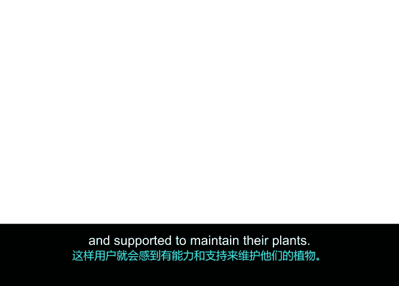

# 谷歌项目管理：专业证书 第5课：《敏捷项目管理课程（Google）》｜agile-project-management｜ - P35：35_04_02_最大化价值驱动交付.zh_en - GPT中英字幕课程资源 - BV1cF411C7kN

Hi again，Previous you learned how to effectively implement Scrum so that you and your team can deliver amazing products to your users in this video we'll explore the results of a project and the end product you'll ultimately deliver。

 which is what holds value for the user and the customer。

I'm going to define the term value as it relates to project management。

 then I'll share some strategies and tactics you can employ to maximize the value your team delivers。

The end product of a project is what provides value to the user value could be financial benefits。

 user growth and engagement， or compliance adherence。

The term value can mean different things for each customer based on what they expect the product to accomplish。

 The number one agile principle is to satisfy the customer by delivering valuable software。

You can always replace the term software with the words product or solution for non software related projects。

Delivering value as quickly and efficiently as possible to users is the primary reason Agile came into existence。

The term value driven delivery means you and your team are focused on delivering a product of high value。

Just because you deliver a product， that doesn't mean it's valuable。

As I explained during the overview of Agile history。

 there was a growing problem of project teams churning out products that weren't very valuable。

 this is because teams were focused on the process and weren't taking the time to evaluate the usefulness of the product until the very end after it had been delivered。

Agile redirects the team's focus to be about the product and ensures that the process for producing the product supports the goal of delivering value。

How can you make sure your team is focused on value driven delivery？Build the right thing。

 build the thing right， and run it right。Remember， Agile and Scrum evolved out of the software industry。

 so the terms build and Run describe processes for building or running a software program， machine。

 or other technology。You can replace the words build and run with terms like create， produce。

 or deliver for non software projects to describe the same concept。Let's break this down。

First and foremost， to deliver value， you have to build the right thing。

 You can do this by making sure you really understand what your customers want。

You might ask a customer what they want， and they may say they want to build a website to promote their new plant service。

 but take this one step further and ask about their goals。

 do they want to increase their brand recognition， do they want to get more customers？

Having a solution oriented conversation with your customer will help you build the right thing。

The agile value of individuals and interactions over processes and tools extends beyond just the team。

 it refers to having those important interactions with our customers and users too。

Next you must build the thing right， that's lingo for ensuring that your team only builds the requested or approved features working on features that aren't necessary can lead to complexities in the product that don't add any value to the users in addition。

 building more than you need delays or reduces your value upon delivery。

 it also increases the risk of bugs or other issues down the road。And finally。

 in addition to building the right thing and building the thing right。

 you have to make sure that you're running it right。

 to run it right means that your team has thought through how the user will interact with the product once it's been delivered。

 make sure your team thinks through some of the operational tasks that will need to be addressed after the product has left the door。

Ask the following questions， how do users get support？

How does the product add value to users long after they initially received it？

And how do you make sure that new features and capabilities reach the existing users？

Building the right thing， building the thing right。

 and running it right all work together to ensure that the team creates a steady and continuous delivery of value to users throughout the life of the product Let's consider how the virtual Verde team can ensure that they focus on value driven delivery。

First， how could the virtual Verde team ensure they build the right thing？

How do they know they're creating something the customer really wants in this case。

 the team needs to ensure that they create a service providing the types of plants that customers want to buy。

So they could create a survey that ask current and potential customers what their plant preferences are and the type of home office design they want to create。

Then they'll use this data to update the user stories on their product backlog。Next。

 how could the virtual Verde team ensure they build the thing right？

Once the team knows what kinds of plants and designs the customer wants。

 how do they ensure the right processes are in place to deliver them？Well。

 the team can secure a trusted plant vendor that carries the desired plant types and work with designers to make pots。

 vases， and other plant accessories in the different design styles that customers like。

 the team can also communicate with marketing to make sure the types of plants and designs that customers want are prominently featured on the website and in the catalog。

And finally， how can the virtual Verday team make sure to run it right。

 how do they ensure customer satisfaction once a customer has signed up for the service。

 how does the virtual Verde team retain their customers long after their plants have been delivered？

The virtual Verde team can send out followup customer satisfaction surveys that ask about their plant and design offerings。

 delivery times， plant quality， and other insights the team can then use this data to continually evaluate their vendors。

 plant and design offerings and marketing strategy。For example。

 the team could find ways to increase the quality of service by offering watering cans and automatic plant health systems or even free monthly gardening tips。

 so the user feels empowered and supported to maintain their plants。

There are many ways to maximize your team's value delivery， building the right thing。

 building the thing right， and running it right， all work together to ensure that the team delivers value to users in the next video I'll teach you another effective proven way to deliver value called a value roadmap meet you there。

