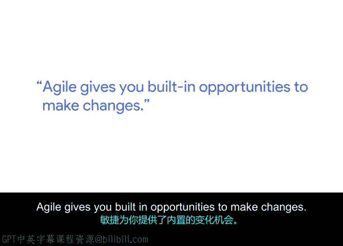

# 谷歌项目管理：专业证书 第5课：《敏捷项目管理课程（Google）》｜agile-project-management｜ - P36：36_04_04_Camron：敏捷如何驱动价值.zh_en - GPT中英字幕课程资源 - BV1cF411C7kN

My name is Cameron。 I'm a technical program manager。

 A technical program manager is a program manager with a technical background that enables them to engage in technical conversations or decisions with her team。

 My favorite thing about agile。😊，Has got to be the flexibility。

So when you're making most of the decisions at the beginning， when you know the least。

Not all those decisions might be right， some will， but probably all of them won't be。So with agile。

 it's a framework and a mindset that is open to that change。 It embraces it。

 It welcomes it as you learn more。 Agile gives you built in opportunities to make changes。😊。

An important aspect of agile is incremental delivery。You're delivering little bits。

Over the course of a long period of time。To contrast that， you think of waterfall。

 That's when you deliver everything at once to the customer at the end In a waterfall project。

 you have to wait and wait and wait until the very end to get everything。And perhaps you're waiting。

Days， months， years。And you cannot extract any value out of it until the very end。

 until the product is delivered。I think that makes sense for a house。

 I think that makes sense for a car。I cannot give someone parts of a car and have them start。

You know， getting value out of it。Because car has certain safety requirements for things that take longer to figure out for more challenging design issues。

You don't have to sacrifice the entire project。For that one last bit。

 if you built 90% of the project。And you can ship it， go ahead。Agile lets you extract that value。

That way people can use that 90% while you're trying to figure out that last 10。

 and then hopefully you have an ecosystem where it's okay to deploy or release that last 10%。

Down the line change is never free because you've already communicated plans。

 you've already made estimates。 you already have some work in progress。

 Then if you're going to change that， you're going to lose a little bit about。

 is that change within your threshold。Or your budget to be able to adapt to get it right or get it better。

 So it's not always about it being perfect。 It's about it being good。

