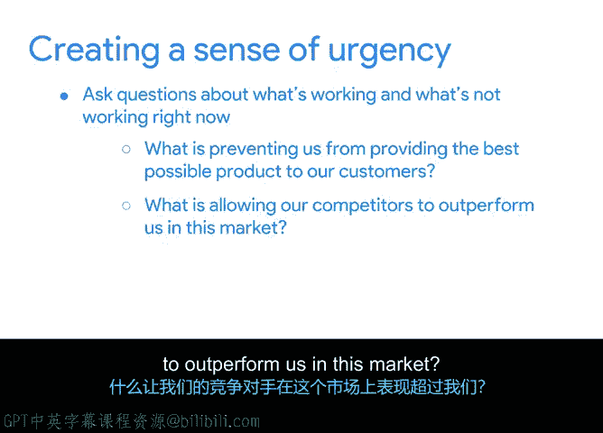

# 谷歌项目管理：专业证书 第5课：《敏捷项目管理课程（Google）》｜agile-project-management｜ - P39：39_04_01_促进组织变革.zh_en - GPT中英字幕课程资源 - BV1cF411C7kN

Hi there In this video I'm going to discuss your role as a project manager in an organization that wants to implement Agile practices。

As you conduct your project management job search， you're likely to find many of the organizations you apply to as either already being agile。

 making the switch to becoming agile or not yet agile but ready to transition。

As an entry level project manager， it's not likely you'll be expected to lead a complete change to Agile in a large organization。

 but you may be expected to help support the change process。On the other hand。

 you might get hired by a smaller organization that does want you to lead the change。

The techniques I'll share with you in this video will set you up to be prepared for all of these different scenarios。

 let's begin。First， let's review some of the key learnings from one of the earlier courses on organizational culture and change management。

When an organization shifts the way it conducts business。

 it usually requires a shift in its culture as well。

Understanding organizational culture and the change management process is crucial when introducing new ways of working。

Organizational culture is based on shared workplace values and pops up in people's behaviors。

 activities， the way they communicate and how they work with each other。

A change that's out of sync with the existing culture is much more difficult to complete In fact。

 there's research proving that companies that don't consider the cultural aspects of Agile are more likely to fail Change management is the process of getting folks to adopt a new product process or an Agileles case。

 a new value system okay let's get into how to help introduce or continue the adoption of Agile or scrum into an organization。

Unless the organization has many years of agile behaviors and experience。

 you may be facing a change in organizational culture。These changes take time。

 sometimes years to complete。As a project manager， you might only implement a few changes and that's okay。

 you'll still be adding value by demonstrating to your team or organization new and different ways of approaching their business。

I'll share with you some words of wisdom I heard from a colleague many years ago。

 they said change takes patient persistence。It may feel like things are taking too long。

 but in many cases， small changes add up to a big change in the long run。

So what are some ways that you can bring Agile or scrum to a new team？First。

 I want you to think about the concept of creating a sense of ownership and urgency。

When people feel a sense of ownership and urgency around a project， it increases interest。

 motivation， and engagement with the project outcome。

One way to create a sense of ownership is to find an executive sponsor who also feels a sense of ownership for the change you're creating。

Wherever possible， point out connections between the changes you're making and the company's stated mission or values having buy in from someone at the top increases your chances of successfully driving any change in organizational culture。

Ideally， your sponsor will reinforce the benefits of Agile to the organization and give you the support and resources you need。

What about creating a sense of urgency？My favorite approach to this is to ask the team。

 the organization， and the stakeholders questions about what's working and what's not working right now。

Then I ensure the changes relate directly to those opportunities。

Here are some questions you could try。What is preventing us from providing the best possible product to our customers？

What is allowing our competitors to outperform us in this market？

And how can we help our teams become more productive and supported in their work this not only helps you prioritize your work。

 you get the team thinking about the possibilities they'll enjoy if the change is successful。

You can use these questions going forward to collect feedback during the change。

Coming back to these questions and demonstrating the incremental improvements is the true spirit of Agile。

Let's come back to our friends at Vi Verde when the team set out to create this agile project and change towards an agile approach。

 they realized that the CEO of Office Green wanted to make sure they took advantage of the market trends since more people were moving to home offices。

They created a sense of urgency by highlighting that home office decorating was becoming a hot online trend。

 and they wanted Office green to become a part of the action。Lastly。

 the virtual Verde team had lots of experience from their plantt Palace project so they could gather a team who was motivated to apply what they learned and try a different approach to a new market opportunity。

Bringing Agileular Scrum to a new team could be challenging， but well worth the effort。

 by applying some of these techniques， you'll increase your chances of success。

I found that with a little patient persistence， you can get past some of the initial skepticism and the benefits of an agile approach will start to become obvious to the team。

Once this happens， change will become easier to drive over time with their commitments I once had a large global team at Google of about 200 developers my director and I wanted to transform them into an agile organization。

It took us about two years and many trips to different work sites for me and my team of project managers to deliver the tools。

 processes， and coaching to bring the team up to speed on an agile way of working。

I approached that transformation very much like how I described here， and it worked。

In the next video， I'll share some tips for coaching new and developing Agile teams， meet you there。

