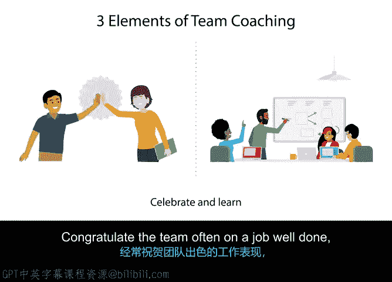

# 谷歌项目管理：专业证书 第5课：《敏捷项目管理课程（Google）》｜agile-project-management｜ - P40：40_04_03_教练敏捷团队.zh_en - GPT中英字幕课程资源 - BV1cF411C7kN

Hi again。As the project manager or scrum master， you're in the position to help the team improve。

In other words， you're the designated agile Co。You're there to help the team recognize areas for improvement and help them implement solutions。

In this video， I'm going to break down your role as a coach into three steps。

 similar to how you might approach being a coach for a sports team。First。

 you'll design the plays with the team。Second， you'll provide feedback to the team。And lastly。

 you'll celebrate and learn with the team。Let me elaborate on each area a bit more。First。

 the scrum master designs the plays， although the scrum master owns the playbook。

 it should be created with the whole team。The playbook should include how the whole team runs a sprint review。

 how the team works day to day， and how the team publishes plans to stakeholders when updates are needed to the team's plays。

 it's important that you involve the team in any decisions。Take them through new processes together。

 think through all the positions on the team， and make sure everyone notices the flow。

A personal example of this was when I facilitated a brainstorm meeting with my team to discuss which parts of our process weren't working。

We use sticky notes to organize our ideas for improvement and then prioritize the ideas to implement changes。

Second is provide feedback。You should always provide feedback to your team and stakeholders as early as possible and on a day to day basis。

 just like a coach gives directions from the sidelines。

 the scrum master needs to provide guidance all the time。

In addition to feedback provided in the moment， the scrum master also takes in a big picture view。

This is similar to how a coach might watch a video recap of the game to find patterns that need improvement or plays that worked so well they should do it every game。

Providing feedback shouldn't only be about fixing broken things。

 but finding processes and activities that work really well and encourage the team to continue using the things that work。

Third， celebrate and learn， congratulate the team often on a job well done。

 a happy customer or a big solution launch， if the team quote unquote  loses。

 meaning they weren't successful in fulfilling a requirement。

 acknowledge that loss as critical data that will help the team improve next time。

It's important for the team to still feel positive about any disappointment and think of it as a learning opportunity。

As Thomas Edison famously said， I have not failed， I've just found 10，000 ways that won't work。

As a Scrum master or Agile project manager， you play an essential role in the team and you're a big part of why Scrum and Agile work at all。

You're responsible for ensuring the team is always improving and becoming the best team it can possibly be。

 Awe， now， you know the three steps of coaching your team， designing the plays with the team。

 providing feedback to the team and celebrating and learning with the team。😊，Next up。

 we'll learn how to anticipate and respond to real world risks with agile and scrum implementations。

 meet you there。