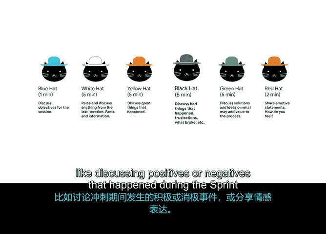

# 谷歌项目管理：专业证书 第5课：《敏捷项目管理课程（Google）》｜agile-project-management｜ - P41：41_04_05_敏捷团队挑战.zh_en - GPT中英字幕课程资源 - BV1cF411C7kN

Hi there。In this video， we'll go through some of the challenges you might encounter during a change process that are specific to Agile teams。

As the project manager or scrum master， it's your responsibility to help teams improve how they work and coach them on how to effectively adopt scrum practices。

 So anticipating an understanding how to work through common challenges before they happen is super important。

 Remember the four themes of agile principles that we discussed in an earlier video to refresh your memory。

 the themes are value delivery， business collaboration， team dynamics and culture and retrospectives。

In this video， we'll focus on challenges you might encounter with an agile team that are related to the first three themes。

The first set of challenges are related to value delivery。

 which is about making sure the team is delivering working solutions frequently。

Some signs that your team is experiencing value delivery issues could include things like。

The team has started missing expected delivery dates and is taking a lot longer than usual to complete tasks。

 Or you might notice that the team seem burned out。

 is working long hours and showing signs of exhaustion。

Or maybe the team has too many items in progress at any given time。

 preventing tasks from actually getting to done。If you start to notice your team is struggling in these areas。

 there are a few things you can do to help。You can try doing more demos of the solutions with the team to ensure they're delivering on the value roadmap。

When the team pauses to take in a big picture view of the working product。

 they often notice areas where they can improve and speed up the work。

You can also use retrospectives to ask the team if anything is slowing them down。

 like waiting on dependencies or communication challenges。

It can also help to do a quick review with the team and make sure that everyone understands what done means。

 And finally。Be sure to focus on only a few user stories per sprint。

 This ensures the team finishes an item together， before moving on。

Putting all this into practice can be harder than you might think。

My current team is asked to cover a lot of ground in each sprint。

 so it can be tempting for us to try and tackle too much at once。

 but doing that usually just makes everything take longer， so it's not actually helpful。

It's better to maintain focus and deliver fewer backlog items in one sprint than to deliver a lot of items in more sprints。

Okay， another set of challenges you might encounter relate to the business collaboration theme to recap。

 business collaboration is about making sure the developers are collaborating with business people on how to build the right product。

There are a few common signs that your team might be experiencing business collaboration issues。

You might notice that the team is overwhelmed with critical feedback or change requests from business people after they reviewed the working solution that could lead to people on your team avoiding asking for feedback or complaining about requested changes coming from the product owner or business team。

Or you might start to detect an us versus them mentality between the team doing the work and management。

I've sometimes noticed this manifest in negative comments from team members like， oh。

 don't give a demo to the salesperson。 It's not ready yet。 And they'll just point out what's wrong。

 If you notice any of these signs， there are a few things you can do to help rebuild trust and collaboration between the developers and the business people。

 To start with， try addressing critical feedback and change requests by doing more demos。

 This ensures feedback comes in at a steady pace。 and that everyone involved has a shared understanding of what done means。

 Next， consider conducting a solution design sprint。

 which is an entire sprint spent working solely on the solution design。

 These are most effective when the working team and the business people actually sit together and collaborate on the solution。

 Finally， you can help your team focus by ensuring changes to the backlog are introduced only in between sprints。

This prevents your team from getting distracted by possible changes。

 which could stress them out and lead to resentment。For example。

 I was once on a scrum team where the engineering director loved to stop by the engineer's desk to ask for a quick dashboard。

 which is a web page that shows data。Asking the engineer to do this completely disrupted the team's focus and slowed down the team's velocity。

We finally decided to ask the director to come straight to the scrum master when they needed something so that it could be planned properly and not interrupt the team's current workflow。

Okay， let's move on to the third theme， team dynamicss and cultureul。

Human beings are complex creatures with lots of different motivations and styles of working。

 so it's likely that you'll encounter at least a few challenges in this area。

Here are a few common signs of team dynamics and culture issues to watch out for。

First is low team morale。If people are super grumpy， irritated， or generally in a bad mood。

 then you might have some underlying team dynamics issues to sort out。Next。

 watch out for signs that the team is experiencing lots of conflict if people are arguing a lot and issues aren't getting resolved。

 the team probably needs some help。Not everyone is going to get their way。

 If team members feel resentful or are holding on grudges。

 it'll negatively impact the team's performance。 And finally， and this might surprise you。

 but low conflict can also be a sign that the teams experiencing issues。

We're usually taught to believe that no conflict is a good thing， right？

 But if a team never has disagreements， it's a sign that they might be worried about starting a conflict because they don't feel like it's a safe environment。

 being open and courageous are two of our scrum values。

 but it's not always easy to put them into practice。 As a project manager。

 part of your role is helping your team get comfortable being honest with each other and working through conflicts together。

 If you notice these or any other clear signs of team distress。 Here are some ideas you can try。

 you could run a team brainstorm session about how to work better together。

Asked the team to identify some areas to improve on an example exercise could involve asking the team to write down stories about the worst team they've ever worked on and the best team they've ever worked on。

 then sharing them in a meeting。Then you might have the team create a list of do's and don'ts for working together based on the stories everyone shared。

Another idea is to change up the workflows， try pairing up people to work together on a hard task。

 or change up the way you run one of your regular meetings。

 it can also help to take a training class together or watch a video about team dynamics and discuss it as a group。

You can also try a retrospective technique from the internet。

There are a ton of great resources out there。 One of my favorite retrospective techniques is called the Six Has Think technique。

 In this technique， each team member chooses a different hat to explore the subject of the retrospective。

The different hats each involve a different objective。

 like discussing positives or negatives that happen during the sprint， or sharing emotive statements。

This helps to ensure that the team takes a well rounded approach to the retrospective。All right。

 That's it for this video。 Now， you've got some idea of some of the common challenges agile teams might face and how to address them。

Coming up， we'll explore some more issues you might encounter as a project manager or scrumma。

