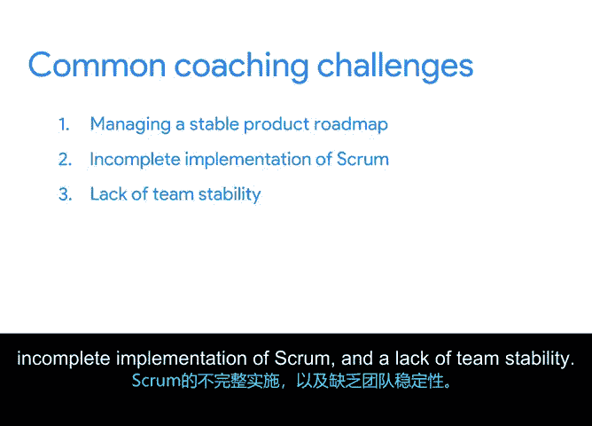

# 谷歌项目管理：专业证书 第5课：《敏捷项目管理课程（Google）》｜agile-project-management｜ - P42：42_04_06_常见敏捷教练挑战.zh_en - GPT中英字幕课程资源 - BV1cF411C7kN

Hi again。In previous videos， we discussed how your role as an Agile project manager or scrum master is similar to the role of a coach。

 We also explored some of the ways you can help an agile team improve their performance。

In this video， we'll discuss some more common coaching challenges you might encounter while managing an agile team or project。

 whether they're a new team or they've been around for a while。

 The three challenges we'll focus on are managing a stable product roadmap。

 incomplete implementation of scrum and experiencing a lack of stability within the team。First。

 let's discuss the challenge of managing a stable product roadmap。

Agile projects almost always experience changes in the product roadmap。

 being able to respond quickly and productively to these changes is a core agile value。

But it is possible to have too much change impacting the project。

 which can lead to an unstable product roadmap。There are two main causes of an unstable product roadmap。

Product ambition and product assumptions。Let's cover product ambition first。

Product ambition poses a challenge when product leadership is overly ambitious about what the team can realistically deliver。

The product owner is responsible for representing the project to customers and executives。

 because the product owner wants to make the stakeholders happy。

 It can be easy for them to over promiseise what the project can deliver。 For example。

 imagine that our Office green CEO notices that the virtual Ver business in North America is doing really well。

In a meeting， they say to the product owner， this is amazing。

 I'd love to launch Vi Verde in Asia in the next four months。

 What do you think The product owner really wants to deliver， So they tell the CEO， sure。

 but the product owner won't actually know if meeting this objective is possible until they discuss it with the team。

 which means they might accidentally be setting an unrealistic expectation with the CEO。😊。

So how do you deal with this challenge here are three ideas to maintain a healthy roadmap management plan between you and the product owner。

First， agree upfront how to handle new opportunities。

 define when they are reviewed and estimated and how customer or management commitments are made。

Second， set up regular road map reviews with the entire team， at least quarterly。

 so that everyone knows what to expect。And third， promote sharing knowledge between the product owner and the development team so that the product owner knows how much effort the product takes to build。

 and the team is aware of changes as early as possible。

The second thing that can cause an unstable product roadmap is making too many product assumptions。

 when there's uncertainty in a project， you may be required to make some assumptions to move things forward。

But making too many assumptions can jeopardize the team's success。

Let's go back to our virtual Verde example。 sendingending plants to customers' homes is a complex process。

 You need to consider a lot of different factors like which plants will sell best。

 which plants will stay healthy in a wide variety of climates and settings and what vendors to work with。

The team does their best to study the market and opportunity。

 but they have to make some assumptions and move forward with decisions relying on less than perfect information。

As a way to deal with product assumption issues， document the assumptions and make them transparent。

This allows you to discuss the assumptions as a team and either agree that they are safe assumptions to make or decide to question and double check them。

If you do decide to double check them， you can use unbiased user research。

Unbiased user research gathers information about what users really want。

 it allows you to confirm or reject assumptions and helps you move forward with confidence。

User research could involve conducting surveys， running focus groups。

 or using other methods to collect objective data about your users。

The next big challenge you might encounter relates to an incomplete implementation of scrum。

This happens when scrum practices are only partially implemented or when scrum practices are implemented without proper support and coaching。

 Scrum roles， Arts and activities are designed to work together as a set。

 If you only partially implement them， you might end up reducing their benefits。

Incomplete implementation of scrum can cause a lot of issues。 First。

 it can lead to a loss of clear roles and responsibilities to implement scrum completely。

 You should define the roles for the team and then fill those roles with specific individuals。

 For example， if you try to have a developer， also act as the scrum master。

 They might not have the bandwidth to do either role very well。

Better to have developers be on the development team。 And you， the project manager。

 be the scrum master。You might also be tempted to skip some events or blend them to save time。

But a lack of clear boundaries for sprint review， sprint retrospective。

 and sprint planning can lead to reduced transparency， inspection and adaptation。

And these are all essential to experience the full benefits of scrum。 And finally。

 not providing the team with the scrum coaching they need would also mean that you haven't fulfilled your role as scrum master。

 It's your job to fully explain the scrum practices and provide coaching。

 So your team understands the reasoning behind the practices and can embrace their benefits。

The solution to all of these challenges is to implement Scrum completely。

 Being the scrum master is a critical role。 You're the coach。

 so you should reinforce the connections between the team's activities and the scrum and agile values。

 For example， if your team complains about daily stand ups。

 Remin them that the purpose of stand ups is to gain feedback， Unblock work。

 ask for help and reinforce the importance of staying focused on the sprint goals。

You can also make sure roles are well defined and properly fulfilled。 for example。

 ensure that all team members understand their own roles。

 as well as the roles of their teammates and how those roles interact。For example。

 the product owner makes sure we build the right thing。

 the development team ensures we build it right， and Scrum masterster ensures we build it fast。

And finally， the last big challenge you might encounter with agile and Scrum teams is a lack of team stability。

When the team changes a lot with people leaving and joining frequently。

 it can make things unpredictable and disrupt the flow of work。

There are a few things you can do to address instability on your team First。

 have a quick onboarding process for new team members to help them get to know the rest of the team and understand the project。

Second， use a pair programming style where a new team member teams up with a colleague and starts learning on the job。

This also helps if people lead the team since a partner should be able to pick up where they left off。

And third， if team composition changes because members keep leaving， try having shorter sprints。

This way， team members can wrap up their last sprint' worth of work before leaving。To recap。

 the three main challenges we've covered in this video are managing a stable product roadmap。

 incomplete implementation of scrum， and a lack of team stability。

I've encountered each of these challenges and more in many of my teams。

The wonderful thing about Agile is that there's a huge community of agileists that are happy to help with any challenges you might come across。

Even an experienced adulist like myself ask for help now and then。Coming up。

 we'll explore how agile is evolving and keeping up with the times。 Now， that's an agile way to be。

