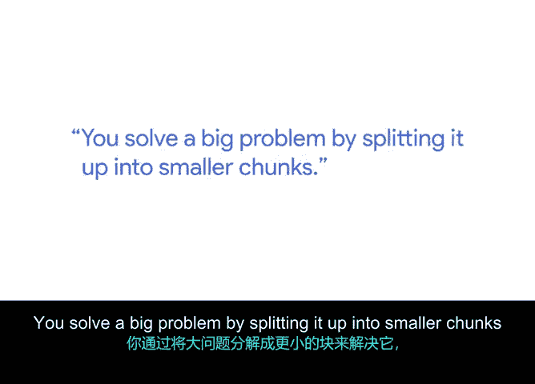

# 谷歌项目管理：专业证书 第5课：《敏捷项目管理课程（Google）》｜agile-project-management｜ - P44：44_04_04_Jez：我对敏捷的思考.zh_en - GPT中英字幕课程资源 - BV1cF411C7kN

🎼My name is Jes， I'm an SRE here at Google and my job is about making sure that Google's systems stay up and are reliable so what would I tell someone who is new to Azile and DevOs about really what this is about and what you do to be effective？

Fundamentally， agile and Devops。Are about solving complex problems。

 You solve a big problem by splitting it up into smaller chunks。

And then working out which of those chunks you can deliver first in such a way that you will maximize the information that you gain。

 which will help you solve the bigger problem。And then iterating and keeping on doing that。

 not only will you discover。Better how to solve your problem in a way that actually makes life better for your users。

 makes them more awesome in what they do。 You'll also discover about how to do that。

 Like what process will work most effectively。 Here's the user problem that we want to solve。😊。

You go and work out how to do it。 What I've seen happen in the last kind of 10 years is。Taking the。

 the， the front end of that process， the planning process and bringing that into the team。

 taking the back end part of the process， the the release and operational part and bringing that into the team。

 and then making that like。Very religiously user centreed。

 so how do we make everything user centered and bring that into the team as well？That that， I think。

 has been a big transformation。 And we are a long way from being done with that。

 The other piece to success in agile that I think people talk about but isn't sufficiently internalized is that。

You are going to make a ton of mistakes。😡，Especially as a new person。

 you're going to make a ton of mistakes。That's okay。 You can't learn if you don't make mistakes。

First of all。Don't expect that you'll get it right the first time or the second time or ever I still make mistakes all the time I've seen actually a lot of evolution of agile over the 15 years that I've been involved in it in organizations of all different kinds all over the world。

 you know it works。😊。