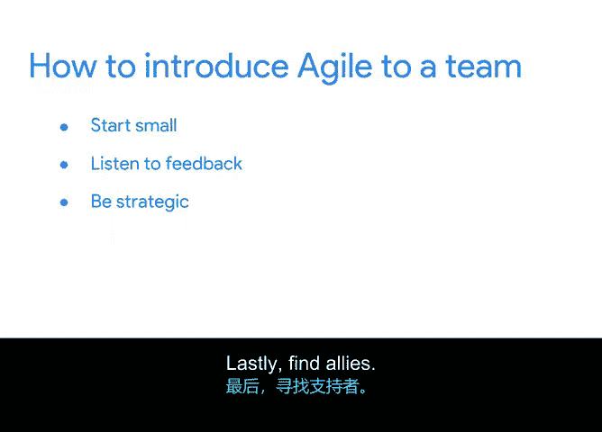

# 谷歌项目管理：专业证书 第5课：《敏捷项目管理课程（Google）》｜agile-project-management｜ - P45：45_04_05_敏捷项目管理机遇.zh_en - GPT中英字幕课程资源 - BV1cF411C7kN

We just covered the evolution of Agile and I shared how other organizations are adopting agile practices。

We also discussed the best mindset for delivering value to users as quickly as possible。

Agile project management opportunities are everywhere。

 whether you're looking for a new role in Agile or want to incorporate Agile into your current lifestyle or workplace。

 I have a few tips to help get you there。 Let's start by discussing how to land an agile project management position。

These types of jobs might show up on job boards as Agile project manager， Scrummaster。

 IT Agile project manager， or a DevOPS project manager。After taking this course。

 youll be a great fit for any one of these。 Look for a role that suits your experience level。

 complements your industry domain expertise and offers growth opportunities。 Also。

 look for a role that provides a culture thatd be a good fit for you。😊。

And I can't emphasize enough how important it is to find an employer who supports your goals and personal growth。

I'm a hiring manager at Google。 I've interviewed and hired many project managers here。

 both agile and non agile。 and I'd like to share how I approach interviewing and searching for an excellent agile project manager for my team。

 Even if a candidate doesn't have Agile on their resume。 One of the first things I ask them is。

 what's the difference between Agile and waterfall project management。

Their answer usually tells me instantly if they know what Agile is about。

 and it's a great launching off point for more follow up questions。

 In the candidate's answer to that question。 I look for a few specific things。

 I want to know whether the candidate knows that Agile is more than just scrum。

 sprints and stand ups。 Do they know it's also about founding values that include customer collaboration。

 value delivery， self organizing teams。😊，I'm also interested to know whether they make waterfall out to be the worst solution。

 or do they know that all projects benefit from certain types of approaches， including waterfall。

 like clear requirements， risk management， stakeholder awareness， and more。I also ask。

 how do you know when to use an Agile approach or frameworks on your project？

Their answer helps me know if they understand how Agile or scrum can help a project manager with specific challenges and what those challenges are。

And finally， I ask， if you are facing resistance with your team following a scrum or agile practice。

 how do you convince them to give it a try Their answer helps me understand how they use communication and influence skills and whether they truly believe that an agile team can be self-organ。

At Google， our teams sometimes resist being told what to do。

 especially because this can diminish innovation and creativity。

 so I always want to hire project managers who work with the team and don't try to force them to do things a particular way。

An important part of every interview is when the candidate gets to ask the interviewers questions。

 these could be questions about the job， about the interviewer's experience in project management。

 about the culture， and about the job expectations this is a huge opportunity for you as the candidate。

As an agile project manager， you now know how crucial culture is to the success of an agile project。

 This is a great time to ask questions that will help you determine if you'll be happy with this job or not。

 Some questions you should ask are how supportive is the management here towards blending project management approaches。

 What's the first thing I should know about the culture here。

 and how often will I get to hear about the needs of our users or customers。😊。

And what would a typical day look like for me if I were to take on this position？

Maybe you're not interviewing for a new role， but you want to bring what you learned in this agile course back to your team。

How would you go about that， as we discussed， bringing Agile scrum to a new team is often challenging if their culture doesn't support it。

Here are four things that helped me bring agile to my teams first， start small。

You may be excited by everything you've learned here， but your team might light things how they are。

 so introduce agile practices in bite sizeized pieces。

 maybe start by using a conban board just to keep track of one work stream or set up a retrospective after a major milestone。

 second， listen to feedback。The most powerful tool a project manager has is the ability to listen to their team and meet them where they are。

When you introduce changes， ask the team how it's going， get their ideas on how to make it better。

 and include them in your approach， this will amplify your small changes into big results for the team。

 third be strategic。Target your improvements to challenges your team has today。

 introduce new ways of working that address head on the biggest issues your team's experiencing。

For example， maybe your team has trouble estimating effort predictably and always ends up in crunch mode。

 maybe relative estimation techniques would help with that。

Or maybe you have too many people chiming in on what the product should be。

 introducing a single person who act as the product owner to help ensure consistency in prioritizing features。

 Lastly， find allies。

You may have setbacks or need to lean on supporters to bring these ideas back to your team find agile allies in your organization or network these allies will give you advice when things get rough and help you stick to agile values and principles we built up a network of about 60 volunteer agile coaches here at Google and we're always leaning on each other for ideas and solutions。

Great， now you have all the tips you need to ace your interview and successfully bring Agile to your team or organization in the next video。

 we'll wrap all this up and set you up for the final course of this program。😊。

