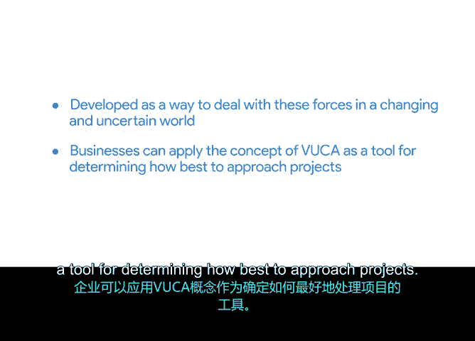

# 谷歌项目管理：专业证书 第5课：《敏捷项目管理课程（Google）》｜agile-project-management｜ - P6：06_01_06_采用敏捷思维.zh_en - GPT中英字幕课程资源 - BV1cF411C7kN

Hi there。Every project exists within organizations and settings with different cultures。

 business objectives and industry dynamics In this video we'll discuss some different scenarios in which you'd want to adopt an agile mindset。

😊，I'll also introduce you to a concept called VUCA that can help you decide which management approach is best for your project。

Remember， Agile is about delivering value in a world with high degrees of uncertainty。

 risk and competition。 It sets a team up to react as quickly as possible to new information。

 new market opportunities and even new technologies。

Agile works best in industries or projects that are susceptible to or that encourage change and uncertainty。

What kinds of businesses or industries besides software come to mind that deal with lots of change。

A few that I think of are biotechnology with emerging vaccines， treatments and technologies。

Media with endless new ways to share content， the food industry with celebrity chefs and the latest food craze and fashion。

 an industry built on keeping up with shifting trends。 Did any of these surprise you。😊。

On the flip side， here are some industries that you might think of as fairly stable agriculture。

 aerospace， manufacturing and mining。 But even these industries with rigorous supply chains and codes have to adapt to change due to new laws and regulations。

 natural disasters and other unforeseen issues。 One thing that the year 2020 taught all of us。

 is that no industry is truly immune to change and uncertainty。

 We're going to explore a concept for categorizing and thinking about these forces that shape our world。

 no matter what industry we're in。That concept is called Vucca。

 and it can help you decide which project management approach is best for you。

 The US Military War College developed a concept called Vucca， spelled V， U， A。

VucCA is an acronym that defines the conditions that affect organizations in a changing and complex world。

 it was designed to help us factor in the forces of change and uncertainty in our projects and businesses。

VucA stands for Vol， Unty， complexityity and ambiguity。

 I'll explain each one and what that could entail in projects and business settings。

First up is volatility。Volaatility refers to the rate of change and churn in a business or situation。

In a volatile project， you would discuss how the next disruption to your operations is always right around the corner。

 or it feels like things never have time to settle into a normal rhythm。Next is uncertainty。

 Untainty refers to the lack of predictability or high potential for surprise In an uncertain environment。

 it would be difficult to create plans for the future that were not based on a large number of assumptions that could turn out to be incorrect。

 Then there's complexity。 complexityplexity refers to the high number of interrelated forces， issues。

 Ors and factors that would influence the project。For example。

 if one product being worked on relied on diverse and global suppliers。

 that would add to the complexity of the project。And finally， we have ambiguity。

 ambiguity refers to the possibility of misunderstanding the conditions and root causes of events or circumstances。

A project that suffered from ambiguity would have difficulty pinpointing the causes of project delays。

 making it difficult to design mitigation plans to reduce the risks。Let's recap。

 Vucca stands for volatility， uncertainty， complexity and ambiguity。

 It's a concept that was developed to deal with these forces in a changing and uncertain world。

Businesses can apply the concept of VUCA as a tool for determining how best to approach projects。

Few， that's a lot of info， but it's all good stuff。

Having an understanding of these concepts will help with decision making in all kinds of projects。

 Ading an agile approach increases your chances of success， despite this uncertainty。

And these concepts apply to the business world at large， not just projects。Let's take a little break。

 then we'll wrap up this section by checking in with Office Green。

 the example business for this course， to find out how they can apply these new concepts from Agile and BuA to a new project。

