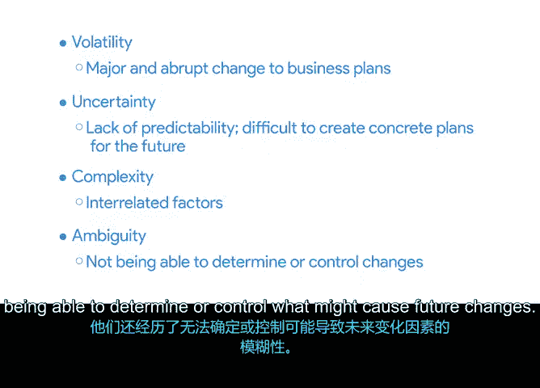

# 谷歌项目管理：专业证书 第5课：《敏捷项目管理课程（Google）》｜agile-project-management｜ - P7：07_01_07_在VUCA环境中应用敏捷.zh_en - GPT中英字幕课程资源 - BV1cF411C7kN

Welcome back。In the last video， I taught you about Bua。 Can you remember what it stands for。

Vololaility， uncertainty， complexity and ambiguity。 great。 in this video。

 we'll examine a project scenario with high Vca parameters and how the office screen team applied an agile approach。

😊，Now， let's discuss why it's important to understand VUCA as it relates to project management。

When we get started on a new project， it's helpful to examine the environment and conditions in which the project exists before we decide the best approach to use。

If your project environment has high levels of volatility， uncertainty， complexity and ambiguity。

 then it's a good sign that you should consider an agile approach。

 While an agile approach is not a perfect solution that will get rid of Vucca。

 it will lead to better outcomes by giving you and your team tools and systems to mitigate the risks that Vucca presents。

When you consider Agile values and principles， it's clear that Agile is a proven and well documented solution to the challenges VUCA presents to your project。

Okay， let's revisit the Office Green scenario we introduced earlier in the program。

 we'll use this scenario throughout this course as well to illustrate the power of an agile approach to project management。

If you're just joining us now， I'll give you a quick recap in previous courses。

 learners acted as the lead project manager at Office Green LLC。

 a commercial landscaping company focused on interior plant design for offices。

 restaurants and hotels。For this Agile course， we'll come back to Office Scen as they pursue a new business opportunity。

The Office Green Market research team noticed a major shift to more workers setting up and working from a home office。

 They wanted to react fast to a potentially huge market opportunity and not lose revenue if businesses had less need for their previous office service。

Instead of offering indoor landscaping designs for businesses。

 Office Greenre wants to find a way to capture this new market full of home offices。

I don't know about you all， but I have a hard time keeping plants alive， I can't keep a cactus alive。

 but I love all those video conference backgrounds that are so nicely decorated with beautiful live plants。

😊，This shift to working from home came about suddenly。

 So Office Green didn't have any project plans to start from。

They didn't have time to do a lot of prep work， but they wanted to maximize this opportunity before it was too late。

To do this， Office Green assigned you to be the project manager of a scrappy new Agile team。

Your goal is to deliver their new service called Virtual Verde。

What environment did office Green face， volatility， uncertainty， complexity and ambiguity。

 They experienced volatility in the form of a major disruptive change to their business plans。

 Untainty through a lack of predictability， which made it difficult to create concrete plans for the future。

A high level of complexity due to interrelated factors like suppliers and the economy。

 and they experienced ambiguity by not being able to determine or control what might cause future changes。

By using an agile approach to their project， Office Greenen was able to address high LUCA factors that were affecting their business。

Instead of business slowly or quickly eroding due to market forces。

 Office Green embraced the changing market and remained flexible in how they approached their next project。

We'll follow along with Office Green and your work as a project manager of Vi Verde throughout this course and find out how you do。

