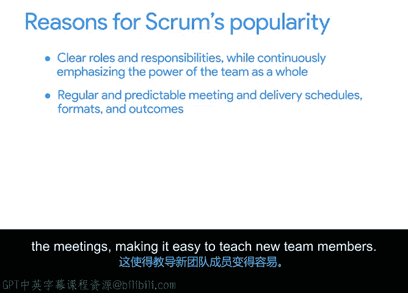

# 谷歌项目管理：专业证书 第5课：《敏捷项目管理课程（Google）》｜agile-project-management｜ - P8：08_01_01_Scrum简介.zh_en - GPT中英字幕课程资源 - BV1cF411C7kN

Welcome back。So far， we've explored a little bit of agile history， the agile manifesto。

 and some of the types of projects that benefit from an agile approach。Up next。

 I'll introduce you to some specific methodologies under the Agile umbrella。

The most popular of these， by far， is scrum。In this video。

 I'll briefly recount the origins of Scrum and discuss the basics of scrum methodology。

So what the heck is scrum， Well I'll tell you first that it's not an acronym。

If any of you have ever played or watched the sport of rugby， you may recognize the term。

For those that aren't familiar with rugby， it's similar to American football。

 a full contact sport played on a field with a similar shaped ball。

Scrrum refers to a formation in rugby where all of the players on the team lean forward。

 lock their heads together， and then work as one unit to try and gain precious yards towards the scoring line。

The originators of the Scrum methodology saw their team as a heads down group working very closely together to get that ball down the field。

 just like scrum in a rugby match。So how does the Scrum methodology work as a project management methodology。

 I'll give you a brief overview here and we'll dive into it more throughout this course。

If you work in Agile project management， it's highly likely that you'll use Scrum or an approach that is based on Scrum。

In the 2019 state of Agile Report， 72% of teams using Agile methods were using Scrum or a hybrid。

When you use Scrum for project management， you form a team that will work together to quickly develop and test a deliverable。

The work is completed in short cycles， and the team meets daily to discuss current tasks and clear up anything that's blocking their progress。

First， let's review some terms and concepts specific to scrum。

The backlog is the central artifact in Scrum， where all possible ideas， deliverables。

 features or tasks are captured for the team to work on。

It's prioritized and proactively managed by the team continuously throughout the life of the project。

The sprint is the name of the time box period in Scrum where work is done。

The sprint can be between one and four weeks long， but most sprints are around two weeks。

This is often called the iteration。And then there's a practice called the Daily Scrum。

 also called the standup This is where the team meets for 15 minutes or less every day of the sprint to inspect their progress toward their goal。

Next are the roles， the first of which is the scrum master。

 This role is responsible for ensuring that the team lives， Agile values and principles。

 follows the processes and practices that the team agreed to。

 sharing information to the larger project team。 And they also help the team focus on doing their best work。

The other notable role in Scrum is the product owner who is responsible for maximizing the value of the product and the work of the team。

The product owner owns the inventory of work and has the final say on how to prioritize the work。

And the development team is responsible for how a team will deliver that product。

Scrum is popular for many reasons。 First， it has clear roles and responsibilities for the folks on the team。

 while continuously emphasizing the power of the team as a whole。

Scrrum has a very regular and predictable meeting and delivery schedule with predefined agendas and outcomes for the meetings。

 making it easy to teach new team members。

It supports and reinforces the agile values and principles while adding some structure and foundations that help new Agile teams get started and more experienced teams get better。

And it's all free and open for all to use。Since it's the most commonly used Agile delivery framework。

 there's also a huge amount of guidance and support online as well as scrum specific training and certifications。

Scrum lends itself best to the following types of projects and teams。Ideally。

 a scrum team should be cross functional with around three to nine team members。

 some call this a pizza size team because it has the same amount of people who could share a large pizza。

If the team is too small， you might not have the diversity of skills to get work done。

If the team is too large， it gets hard to distribute information。Lastly。

 Scrum works best for projects where the team and management are open minded， adaptable。

 and value continuously learning how to be a better team。

Trying to force a team to do scrum will almost always fail。Note that in all of these examples。

 I never once mentioned the word software。Although scrum emerged from software projects。

 people have adapted Scrum to suit all kinds of projects from wedding planning to house moves to building rockets。

Great， you now know some of the key characteristics of Scrum and which types of projects can really benefit from it。

 It's an exciting method。 And while we have much more to discuss before you can fully implement Scrum。

 we'll first discuss a few other popular agile methodologies。😊。

Learning about these approaches will help you become a well rounded。

 versatile member of any project team， so what are you waiting for， Me me in the next video。

