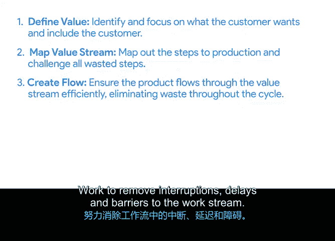

# 谷歌项目管理：专业证书 第5课：《敏捷项目管理课程（Google）》｜agile-project-management｜ - P9：09_01_03_Kanban、极限编程和精益简介.zh_en - GPT中英字幕课程资源 - BV1cF411C7kN

Hi again。There are many popular Agile methodologies that are still around from the 90s when Agile was invented。

These methodologies share agile values and principles。

 but have very specific practices and applications。 In this video。

 I'll touch on a few of the most popular ones beside Scrum， which we covered in the last video。

 First， one of my personal favorites is Kanban。 This is a methodology that can be applied in a very simple way。

 or it can be used to drive the entire project。The Kanban name comes from two Japanese words， Khan。

 meaning sign and B， meaning board。You may have already used a Com board because it's the most famous feature adopted by the majority of agile enthusiasts。

The reason Kban is so popular is that it provides transparent。

 visual feedback to everyone who might be interested about the status of work in progress。

Conban boards or charts display the progress of a project as to do in progress and done。Also。

 just so you know， there are software tools that create digital con boards for you。

The Kban method ensures that the project team only accepts a sustainable amount of in progress work。

This means the amount of in progress tasks are limited to what the team can actually handle during a certain amount of time。

This is called the Work in progress limitit or WI limit。The whip limit is decided on by the team。

 This is a reflection of agile in that teams are both self organizing and empowered。

 and they are operating at a sustainable pace。 The team members add new tasks to be completed only after they finished their previous task and are below the whip limit。

This approach means that once a task has started to be worked on。

 it becomes a priority for the whole team to get it to done。By focusing on less work。

 the work gets done faster。This goal of trying to maximize efficiency is called flow and is a core principle of Kanban。

Another agile methodology is extreme programming or XP。

 It was named that because it took traditional software development activities to an extreme level。

 but I also believe it's because it emerged at the same time as extreme sports like snowboarding。

X P is another one of my personal favorites。 It was the first agile methodology I was introduced to back in my days working on some of the original cell phones at Qualcomm。

 the company behind the radio technology we all use in our phones today。😊。

Since XP came out of the software industry， it refers to specific software terms and activities like coding and programming。

But the XP method can be used in lots of non software environments as well。

The XP methodology aims to improve product quality and the ability to respond to changing customer needs。

It does this by taking best practices for the development process to extreme levels。For example。

 one best practice is the idea of test first development。

 This means testing out parts of the product before building them in full。Often。

 only the larger features get tested， which is still good， but means some details might get missed。

XP takes this practice to the extreme by finding ways to test more and smaller features of the product to get even more feedback。

There are four basic activities that are performed during the product development process that the XP method tries to enhance。

Designing in software development， this is where you write a design document describing the parts of the code or instructions for the product and how it will function。

In non software environments， this would be describing the various pieces and parts for whatever it is you're trying to deliver for example。

 if you're delivering an ad campaign， maybe the main pieces are the artwork， the copy。

 and the a Bu plan。X P wants to ensure that all of the pieces of the product will fit together properly。

 so it stresses simplicity。 Start with a simple design to meet the most basic and important requirements。

Simple designs also take less time to complete once the basic model is designed and has been tested。

 then you can think about adding on other features。Coding。

Code is a language that's used to write software programs。

 It's the instructions that tell the computer what to do。In software development。

 writing clear code is crucial， just like clear writing is crucial in any situation where you want to be understood。

XP demands clear and concise code so that others can easily read and understand the program。

 This makes it easier to troubleshoot problems and come up with solutions。

In non software environments， code would be similar to writing clear and concise processes or instructions for how to build or use your product。

Testing like I described earlier， means checking the product for flaws so they don't end up in the final product in X P。

 more is better。 So if a little bit of testing can eliminate a few flaws。

 lots of testing will eliminate even more。 The goal is to test for and eliminate any flaws in a feature before building it and continuing on。

Testing also means checking to make sure the product features meet the customer's requirements。

Which leads us to listening， which is about listening to the customer and ensuring that the requirements are integrated into the product。

This relates to Agile in the way that it values customer collaboration， frequent communication。

 and regular feedback XP features some other innovative practices that are used across many Agile teams regardless of the specific methodology being used。

First， there's pair programming， which is when two team members work together at the same time on one task。

Usually this is done in the same physical location， but with the use of digital collaboration tools。

 this can happen remotely too Another practice is continuous integration and continuous refactoring。

This is the practice of merging product changes into a shared version several times a day in order to get quick feedback on the quality of the code or product。

Then there'sAvo big design up front。 This relates to designing and means the design should be just enough to get started and should be continuously improved as the product evolves。

And finally， there's right tests， not requirements。

 this means that instead of writing a product requirements document and then later writing a test plan。

 your test plan can serveve two purposes by A， telling the team what to build and B。

 comparing what they built to what was supposed to be built。Okay， so we've got Scrum， Kban and XP。

 let's explore one more。For those of you who took the earlier courses in this program。

 you already learned a little bit about this final methodology called leanan in the context of Lean Six Sigma。

 leanan methodology consists of five principles that serve as a recipe for improving project outcomes。

They are define value， map value stream， create flow， establish pull， and pursue perfection。

 let's break these down。Deefed value means identifying and focusing on what the customer wants and including the customer in the process a product's value is the sum of all the things the customer wants。

Map value streamre means mapping out the process or stream。

 including all the steps involved in producing value for the customer。

It also means challenging any steps that can be considered wasteful or unnecessary。

Create flow means ensuring the product flows through the value stream efficiently。

 continuing to eliminate waste throughout the cycle。Work to remove interruptions， delays。

 and barriers to the work stream。

Establish pull， think of asking someone to pull something off the shelf。

You want to make sure the customer is pulling on the product or asking for it throughout the value stream。

They might pull or ask for features and incremental deliveries。

The idea is to make your process as smooth as possible so that the customer can pull on the product at any time and you'll be able to present what you've been working on or add a feature request。

 Finally， there's pursue perfection This means pushing your team to continuously improve the first four process steps。

So how does this relate to Agile Well， Agile emerged after lean and the inventors of Agile were inspired to apply lean manufacturing principles to software development？

Like Agile， leanan is a set of principles and a value system。

Many of the differences are really just in the wording。Awesome。

 now we know more about some other methodologies that are considered agile。😊，There are several more。

 but the reality is that many teams evolve and blend methods to create the tools and processes that work best for them。

We'll discuss more about how to do this blending in the next video。

