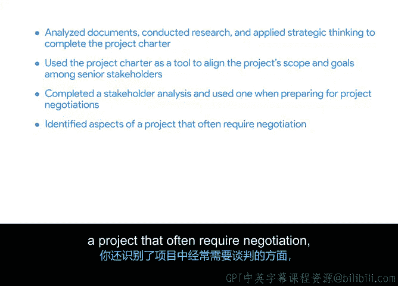

# 谷歌项目管理：专业证书 第6课：《顶尖：在现实世界中应用项目管理课程（Google）》｜applying-project-management｜ - P11：11_01_01_总结_1.zh_en - GPT中英字幕课程资源 - BV1WG411o77A

Hi， and congrats on making it to the end of this section。

 Let's take a moment to review what you've accomplished so far。😊，You started by analyzing documents。

 conducting research and applying strategic thinking to complete the project Charer for So and Sp's tableablet rollout project。

Next， you use the project chartter as a tool to align the project's scope and goals among key stakeholders。

Then you completed your own stakeholder analysis and learned how to use one when preparing for project negotiations。

You also identified aspects of a project that often require negotiation。

 along with aspects that provide benefits that could support a mutually beneficial agreement that works for all stakeholders。

And finally， you applied your knowledge of power and interest to identify people to be part of a coalition aimed at persuading stakeholders to a certain viewpoint。

Defining and getting stakeholders aligned with the details。

 negotiating project scope and goals and being able to effectively influence others are super important to getting off to a successful start in any project。

It's here in the beginning that you want to get clear on what you're setting out to accomplish with the project。

That way， you'll be able to accurately track the project's progress and feel confident that you're working within the time frame and budget allowed。

Being able to practice these concepts， create project documentation and apply this knowledge will help you prepare for job interviews and become a great project manager。

😊，Coming up next， you'll continue to learn from PE in her role as project manager for Sa and Spod。

In the upcoming activities， you'll take the work you've done here and move into the planning phase of the project to build out a project plan with tasks and milestones。

Meet you there。