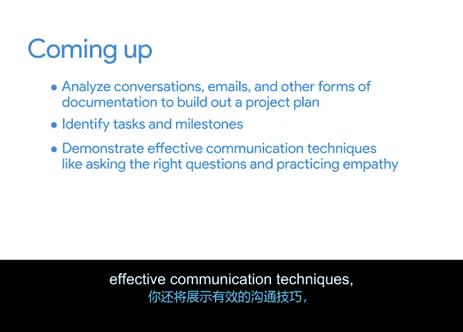

# 谷歌项目管理：专业证书 第6课：《顶尖：在现实世界中应用项目管理课程（Google）》｜applying-project-management｜ - P12：12_02_01_引言构建项目计划.zh_en - GPT中英字幕课程资源 - BV1WG411o77A

Welcome back。So far， you should have completed a project charter for sauce and Spoons tablet rollout。

The project chartter helps you organize vital project information。

 create a framework for the work that needs to be done。

 and communicate those details to the necessary people。

Once the project chartter is created and confirmed。

 you'll use it to start the project planning stage。In the upcoming activities。

 we'll be progressing from the initiation phase of the project lifecycle to the planning phase。

Here you'll put your knowledge and skills to work on a project plan。

 which is the central artifact a project manager builds during the planning phase。

Most projects capture requirements in this artifact。

 So the project plan you build for sauce and spoon will be a critical part of your project management portfolio。

It will demonstrate your ability to break a large project into a set of achievable， smaller tasks。

Before we get started， let's review the project scenario。

Sauce and spoon is a small but growing chain of restaurants with five locations。

They've hired Peter as their first in house project manager to launch the pilot of tabletop tablet menus at two of their locations。

Throughout the course， you'll observe Peter as she works to complete this project in scope on time and within budget。

You'll create project management documents based on the scenario。

 just as you would if you were the project manager。As you work through these materials。

 you may want to take notes about project details in order to complete some of the activities。

The project management documents you create will help you practice your skills by applying them to a real world scenario。

These documents will also provide you with a portfolio to speak to during a future job interview。

In the next group of activities， you'll analyze conversations， emails。

 and other forms of documentation to build out a project plan。As you continue on。

 you'll identify tasks and milestones within the sauce and Sp tablet rollout。

You'll also demonstrate effective communication techniques。

 like asking the right questions and practicing empathy。

Which will help you make accurate time estimates for each task。Ready to get started。

 Meet me in the next video。