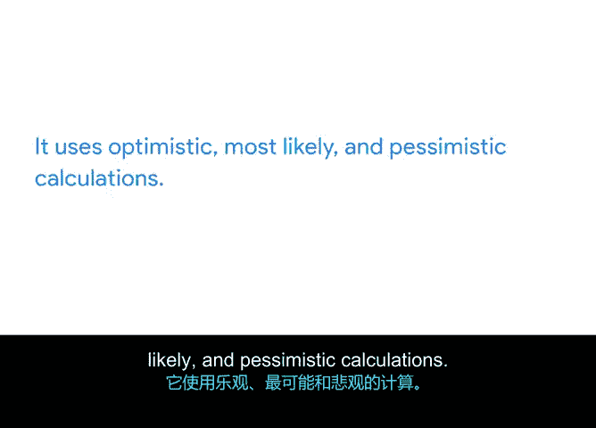

# 谷歌项目管理：专业证书 第6课：《顶尖：在现实世界中应用项目管理课程（Google）》｜applying-project-management｜ - P18：18_02_02_时间估算三点估算法.zh_en - GPT中英字幕课程资源 - BV1WG411o77A

Hi again。 I've got one more technique for figuring out accurate time estimates。

 It's called three point estimating。Three point estimating is used to help determine the most realistic time estimate for a task。

It uses optimistic and pessimistic calculations， meaning calculations based on the best case and the worst case scenarios。

A side benefit to this strategy is that it takes into account potential risks that could impact not only the task estimation。

 but other aspects of the project， like budget and resources。

Just as the name implies in three point estimating， there are three parts of the estimate to examine。

Here's how it works。Each task receives three time estimates。Optimistic， most likely， and pessimistic。

Each estimate indicates the projected amount of time a task will take under that category and how likely any potential risks are to occur。

An optimistic estimate assumes the best case scenario。Issues will not occur。

 and the task will be completed within the estimated time。In other words。

 it's how long you hope the task will take， assuming everything goes as planned。 For example。

 if all the supplies needed for a task come in early and everything works the way it's supposed to。

A most likely estimate assumes some issues might occur。

Another way to think about a most likely estimate is that it is based on how long the task usually takes under normal circumstances。

Like if the supplies arrive at the expected time and you only need to make some slight adjustments before everything eventually works the way it's supposed to。

And finally， a pessimistic estimate assumes that issues will definitely occur。

This is where everything that could go wrong does go wrong。For example。

 if the supplies are late or the order is incorrect and nothing works the way it's supposed to。

When determining estimates using this technique， you'll need to ask your task experts questions or conduct research that will help you understand best and worst case scenarios。

Then add these notes to the plan for each task。Let's try out three point estimating with an example from the sauce and Spoon Project。

The task of training the staff to use the tablets。You ask the person tasked with arranging the staff training to give you a time estimate in each category and to describe the conditions for each。

The task expert tells you that the conditions for an optimistic estimate would mean the vendor who is hired to do training is well qualified。

 has all the materials they need and shows up on time to deliver the training。

All of the staff shows up on time and successfully completes the training within the scheduled amount of time。

All of the equipment works for the staff to practice on。In this best case scenario。

 your task expert estimates four hours。Two hours to conduct the training and one hour each for setup and post training review on the originally scheduled date。

In a most likely scenario， the task expert assumes that the vendor is qualified but might not have all the necessary materials。

 so they'll need to modify something or someone on the restaurant staff will need to find some supplies。

Or the vendor might be new and need extra time to prepare or take longer to deliver the training。

Usually a couple of staff members can't attend or be on time。

 so extra training time would need to be scheduled。

There could also be some minor glitches with the equipment。

 and the training might need to be rescheduled for a different day later in the week。

The time estimate in this case is closer to 6 hours。

 and the date is likely to get changed to two or three days later than originally planned。

 Under pessimistic conditions， you could have a situation where the original training vendor quits and a new vendor has to be hired。

There could be several unexpected staff no shows or turnover right before the training。

Or possibly the equipment doesn't get delivered on time or doesn't work。

 so the training can't happen until the new equipment arrives。😡，In this case。

 the actual training time is still around 6 hours， but the date has to be rescheduled for up to a full week later than originally planned。

When conducting your own research or having conversations with task experts。

 be mindful of the three points so that you can determine the outcomes of optimistic。

 most likely and pessimistic timing。If someone quotes you a time estimate。

 don't just take their word for it without understanding the context they're estimating from。

Think about it this way。 If someone is being optimistic。

 they might estimate that a task will only take them two days to complete。

If you go with that estimate and it ends up taking the whole week， your schedule is off。

 But if someone is being pessimistic and quotes one month and the task only takes a week。

 then you've got extra time in your schedule that could have gone toward other tasks or LED to an earlier product release。

Always accounting for a worst case scenario might seem like a good thing。

 but it's actually wasteful if you calculate most of your estimates this way。

So you want to examine the best and worst case scenario timing and compare these with the most likely scenario From there。

 you can build in a buffer that accounts for risks that are likely。

 but still keeps the project progressing at an efficient rate。Okay， let's review。

Three point estimating is a technique to help determine the most realistic time estimate for a task。

It uses optimistic， most likely， and pessimistic calculations。

Three point estimating takes a little more work， but it gives you a clearer sense of what's possible with each task so you can make a more realistic and accurate estimate。

There are even formulas to help you quantify these estimates that we won't get into here。

 but we encourage you to check out in the course readings。😡，In the next activity。

 you'll review the supporting materials where Peter has had conversations with some of the sauce and Sp project task experts。

Then you'll come up with time estimates for the tasks they discussed and add them to your project plan。

😡。