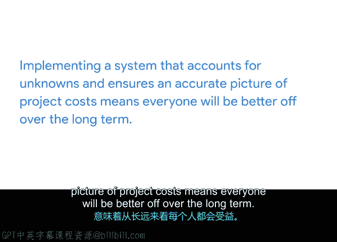

# 谷歌项目管理：专业证书 第6课：《顶尖：在现实世界中应用项目管理课程（Google）》｜applying-project-management｜ - P19：19_02_04_时间估算应用置信度评级.zh_en - GPT中英字幕课程资源 - BV1WG411o77A

Welcome back。Earlier， we discussed how to get accurate time estimates from your experts。

In this video， we'll discuss how to determine a confidence level rating for each of your estimates。

A confidence level rating indicates how confident you are in an estimate's accuracy。

Being able to share these ratings with stakeholders is helpful because they indicate how likely it is that a task will be completed in the amount of time estimated。

Estimating is not a perfect science。 So adding a confidence level rating for a task allows you to address any uncertainty。

In an upcoming activity， you'll finish calculating your time estimates and add confidence level ratings to your tasks in the sauce and Sp project plan。

Let's get started。A confidence level rating ranges from high。

 meaning you're very confident in your estimate to low。

 meaning you're not very confident in your estimate。

Knowing the confidence level of your estimate and adding notes about any risks or issues that might affect the estimate can help you identify whether you should ask the project team for their input。

They might be able to point out the estimates or tasks you should track more closely。Additionally。

 if you notice that your confidence is low across a large percentage of task estimates。

 you might want to communicate your uncertainty about the project timeline to stakeholders。

There are a few ways to determine a confidence level reading。

Using the three point technique we just discussed is one way of gaining confidence in your estimates。

If you can show that you've considered the best and worst case conditions for a task。

 then your confidence level rating for that task's time estimate would be high since you have a thorough understanding of the task。

Another way to determine a confidence rating is by pulling your team about the tasks they assigned and coming to a consensus about your collective confidence。

To do this， you could calculate their level of confidence as a percentage。

 which means pulling everyone on their estimates and calculating the average confidence level。

You might find that they're 90% confident， which would mean you have an overall high confidence rating。

 or maybe they're only 60% confident， which would mean you have a medium confidence rating。

Or you could define categories for the team。 For example。

 we've never done a project like this before。We've done this once before。

 We've done this a handful of times， and we've done this a ton of times already。

Each category correlates to your confidence level。 If they've never done the project before or have only done it once。

 then the confidence rating for the time estimate might be low。

Estimating is far from an exact science， particularly in project management。

 when there are so many unknowns。Implementing a system that accounts for those unknowns and ensures an accurate picture of the project timeline means everyone will be better off over the long term。

Okay， let's review what we've covered。A confidence level rating indicates how confident you are and an estimates accuracy。

You can determine confidence ratings in a few ways。

 including pulling your team on the tasks they're assigned to or by defining categories。

 And remember， estimating is far from an exact science。

 particularly in project management when there are so many unknowns。

Implementing a system that accounts for those unknowns and ensures an accurate picture of project costs means everyone will be better off over the long term。

In the next activity， you'll review supporting materials and add confidence level ratings to each of your time estimates。

Coming up， we'll discuss effective negotiation techniques to get even more accurate time estimates。

