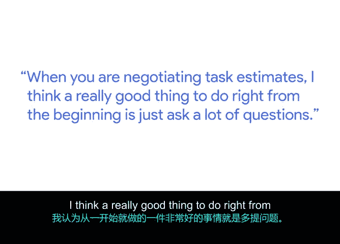

# 谷歌项目管理：专业证书 第6课：《顶尖：在现实世界中应用项目管理课程（Google）》｜applying-project-management｜ - P22：22_02_07_托丽项目经理的同理心实践.zh_en - GPT中英字幕课程资源 - BV1WG411o77A

Hi， I'm Tori and I'm an education program manager at Google specifically I work on our digital literacy curriculum called Applied Digital Ss that helps learners of all ages learn the practical digital skills needed for the jobs of today and tomorrow Empathy can be really important with project management because a lot of times you're dealing with a lot of different potential work styles and communication styles with various members of the team and various stakeholders so you have to learn how to communicate with those different styles and potentially tailor your messaging to different audiences。

 It's really important to be able to understand how different people may feel。

 how they may like to be communicated to so that you can ensure that you are communicating your project goals and your impact in a very impactful way So one example where I've had to practice empathy as a program manager。

Is when I was leading a project with about five different people on the program team。

 we were running into some issues with some misseddes。 actually。

 I had to end up communicating with one of the project team members just to try to understand what was going on。

 Why were some of the deadlines being missed。 Ultimately。

 we discovered that there were some things personally that were going on。

 that we ultimately ended up having to reshift some of our resources and get help from other teammates。

 So that's an example of just trying to meet people where they are。

 understand that there's lots of things outside of work that are also going on。

 And sometimes you can adjust your timelines and your deadlines as needed or get help from other team members along the way。

 So when you are negotiating task estimates。 I think a really good thing to do right from the beginning is just ask a lot of questions。

Just talk to different people on the team， maybe you're even new to the team and you want to get some different experience and folks who have been on the team a little longer and just try to figure out if there are any examples of past projects that are similar to the one that you're leading。

 try to see if there are other projects that may be a little different but have a different timeline I think that can really help in the beginning。

 just ask a lot of questions and collect as much data and information as you can from the beginning。

