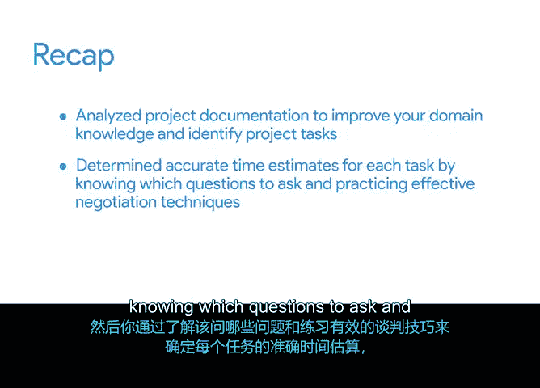

# 谷歌项目管理：专业证书 第6课：《顶尖：在现实世界中应用项目管理课程（Google）》｜applying-project-management｜ - P23：23_02_01_总结_2.zh_en - GPT中英字幕课程资源 - BV1WG411o77A

Great job making it to the end of this section。In this last series of activities。

 you transitioned from the initiation phase of the project life cycle to the planning phase。

 putting your knowledge and skills to work on a project plan。

You analyzed project documentation to improve your domain knowledge and identify project tasks。

 and you uncovered more tasks by conducting online research and analyzing key communications with the project team and task experts。

Then you determined accurate time estimates for each task by knowing which questions to ask and practicing effective negotiation techniques。

You added confidence level ratings to your estimates by using the three point estimating method。

 and you learned how to demonstrate empathy in your conversations about task estimates。

The project plan you've built for sauce and spoon will be an important part of your project management portfolio。

It demonstrates your ability to break a large project into a set of achievable， smaller tasks。

You can also use your project plan during an interview to discuss how you approach project management work。

Up next， we'll get ready to move into the execution stage of the sauce and spoon tablet rollout project by creating a quality management plan。

😊，Talk to you soon。

