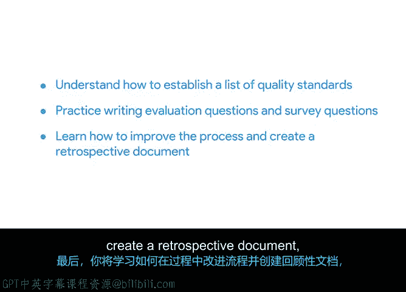

# 谷歌项目管理：专业证书 第6课：《顶尖：在现实世界中应用项目管理课程（Google）》｜applying-project-management｜ - P24：24_03_01_引言保持质量.zh_en - GPT中英字幕课程资源 - BV1WG411o77A

🎼Welcome back。 So far， you've completed a project charter and a project plan for the sauce and spoon tablet rollout project coming up。

 we'll move from the planning phase of the project lifecycle to the execution phase。

 But before you can begin executing， you'll need to make sure your project's quality management plan has been established so you know you're delivering a project that meets your stakeholders expectations。

In the upcoming videos and activities， you'll practice defining quality standards for your project。

Then you'll evaluate how successfully the project standards are being met and present your findings to stakeholders。

You'll also create a retrospective document which project managers use during discussions about project progress and any process improvements that need to be made。

 Before we get started， let's review the project scenario for this course。

Sauce and spoon is a small but growing chain of restaurants with five locations。

They've hired Pi as their first in house project manager to launch the pilot of tablet menus at two of their locations。

Over the next several videos， I'll share helpful information you can use to complete each activity and assessment。

 and I'll offer tips that you can take with you after you complete this course。

🎼By the time we're done， you'll understand how to establish a list of quality standards for one aspect of the sauce and spoon project。

 you'll also practice writing evaluation questions and survey questions that'll help you determine if the quality standards are being met。

 And finally， you'll learn how to improve the process along the way and create a retrospective document。

 which you'll be able to add to your portfolio of project management documents。

Ready to get started， meet me in the next video where we'll get started on developing your quality management plan。

