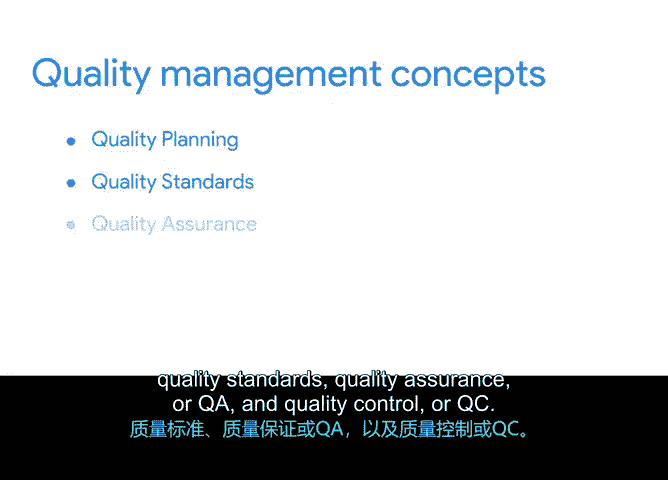

# 谷歌项目管理：专业证书 第6课：《顶尖：在现实世界中应用项目管理课程（Google）》｜applying-project-management｜ - P25：25_03_02_关键质量管理概念.zh_en - GPT中英字幕课程资源 - BV1WG411o77A

Hi again。 In this video， I'll review key quality management concepts and discuss in more detail the importance and purpose of maintaining project quality。

 A crucial part of project planning and executing includes implementing a quality management plan and holding yourself to it throughout the project。

 Quality planning refers to the process that the project manager or the team establishes and follows for identifying and determining exactly which standards of quality are relevant to the project as a whole and how to satisfy them。

 We can't just launch a project and assume everything will be okay。 That's why planning for quality。

 We' clearly defined standards， processes and methods of evaluation is important。

It helps keep you focused on whether or not the project is progressing successfully and alerts you to any adjustments that need to be made to keep the project on track。

 Remember， as a project manager， you're responsible for the planning and execution of the project。

 as well as for the successful completion of the project。

 qualityual planning works together with general project planning and aligns with the overall project process。

 project goals and success criteria for the sauce and spoon tablet project will focus the details of a quality management plan on quality standards。

 evaluation questions and feedback surveys to ensure that the project is delivering on quality and producing a desired outcome After this video。

 you'll practice project quality management by identifying quality standards for the sauce and spoon tablet pilot。

😊，Let's get started。 There are many benefits of creating and maintaining quality management in a project。

Some of these benefits include delivering a quality product。

 decreasing overhead and increasing collaboration in ongoing reviews。

 Overhead is another word for costs。Quality management helps decrease overhead by reducing the amount of errors that would cost the organization money to fix。

Quality management processes ensure that the team is always learning and providing feedback。

 which in turn ensures that the project is on track to achieve its intended outcome。

 In earlier courses， we covered the main concepts of quality management。I'll do a quick review here。

 The main concepts are quality planning， which I defined at the beginning of this video。

 quality standards， which are the requirements， specifications or guidelines that can be used to ensure the materials。

 products， processes and services are fit for achieving a desired outcome。 quality assurance or Q A。

 which is a review process that evaluates whether your project is moving towards delivering a high quality service or product。

 and quality control， often known as Q C。 quality control refers to the techniques that are used to ensure quality standards are maintained when a problem is identified。

 here will focus on building quality standards for the sauce and spoon project， But in many projects。

 All of these concepts get built into an overarching quality management plan。

 which documents all the information needed to effectively manage quality throughout the project lifecycle。

 The quality management plan defines the policies， Pro and criteria for project quality。

As well as the roles and responsibilities for carrying them out。Again。

 there are lots of different ways to develop and track quality management for your project。

 but the benefits and main concepts that make up quality management remain the same。 Let's review。

Some of the benefits of quality management include delivering a quality product， decreasing overhead。

 and increasing collaboration and review。And the main concepts of quality management are quality planning。

 quality standards， quality assurance or Q A and quality controller Q C Understanding these benefits and concepts will help you ensure you deliver a project that meets your stakeholders' expectations。

Coming up， you'll apply your understanding of quality management to develop quality standards for the sauce and spoon tablet rollout。

Meet me in the next video to learn how。