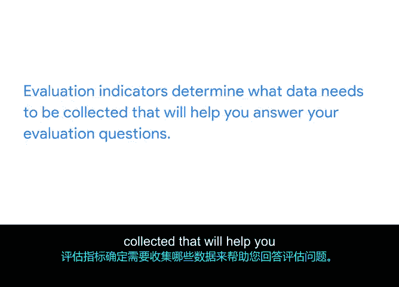

# 谷歌项目管理：专业证书 第6课：《顶尖：在现实世界中应用项目管理课程（Google）》｜applying-project-management｜ - P28：28_03_02_确定评估指标.zh_en - GPT中英字幕课程资源 - BV1WG411o77A

Welcome back。In the last video， we discussed the importance of evaluation and how to come up with effective evaluation questions that address certain aspects and outcomes of your project。

 In this video， I'll discuss how to determine evaluation indicators。

 Eval indicators reveal the specific type of data that needs to be collected to help you answer your evaluation questions。

In the next activity， you'll identify evaluation indicators for each of your evaluation questions and add them to the sauce and spoon quality management plan。

 Simply put indicators state what you want to measure or evaluate， like the number of something。

 level of satisfaction preferences or demographic information such as age， gender。

 experience and so on。Similar to the way quality standards add specificity to your deliverables and goals。

 evaluation indicators take your evaluation question and determine the specific type of response you're aiming for。

You'll need this information to understand whether or not your project or process meets the quality standards that were agreed upon in the project plan。

 Let's return to the sauce and spoon project and the evaluation question， which asks。

 to what extent did tablets improve the staff's work performance？To evaluate this。

 you'll have to ask yourself。How are you going to measure work performance。

 You'll have to decide on indicators of work performance， like faster table turnover rates。

 higher tip averages or higher quality rating from customers。

 Another way to think of indicators is that they provide pathways for answering your evaluation questions。

Indicators demonstrate that the outcomes are achieved and provide measurable evidence of meeting a goal。

They also include visible signs like test scores， attendance rates or observed behavior。

 The word indicate means point out or show evaluationval indicators point out or show the way to answer the evaluation question。

 This could include visible signs of how the staff works with the new tablets。

Observed behavior such as fewer staff members congregating by the beverageever station or arriving late to work could be an indicator of increased productivity。

 or over 90 per cent staff compliance with the tablet ordering process could be an indicator of order placement accuracy。

 Awesome， let's review evaluation indicators determine what data needs to be collected that will help you answer your evaluation questions。

This includes clues， signs or markers that measure one aspect of a project and demonstrate how close that aspect is to meeting the quality standards that have been established。

In the next activity， you'll add evaluation indicators for each of the evaluation questions you added to the sauce and Spoon qualityual management plan。

When you're done， meet me in the next video to get started on developing survey questions。😡。

