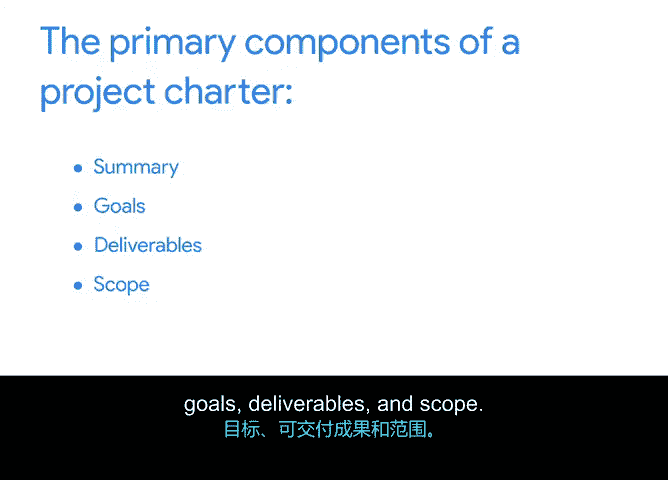
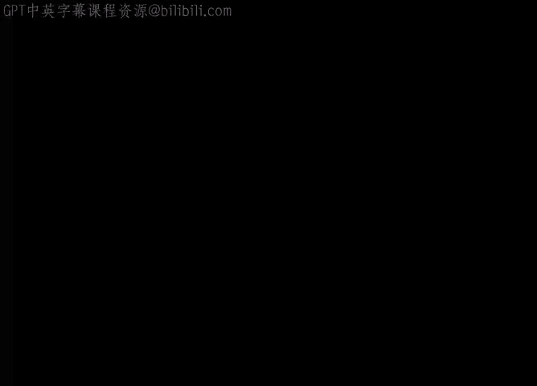

# 谷歌项目管理：专业证书 第6课：《顶尖：在现实世界中应用项目管理课程（Google）》｜applying-project-management｜ - P2：02_01_01_项目章程目的与构成要素.zh_en - GPT中英字幕课程资源 - BV1WG411o77A

Hi again。 Ready to get started In this next set of videos。

 you'll apply strategic thinking and effective business writing to initiate a project。😊。

You'll analyze project documents and supporting materials to identify project requirements。

 evaluate stakeholders and problem solve。You'll use a project charter as a tool to align project。

 scope， and goals among stakeholders。And you'll apply effective negotiation skills with stakeholders to prioritize project goals。

In this video， I'll review the purpose and main components of a project charter so you can get started creating one for the sauce and spoon tablet rollout。

😊，After this video， you'll review supporting materials that will enable you to observe Peter as she initiates the project。

Then you'll apply strategic thinking to create a project charter based on what you observed。

Strategic thinking involves analyzing documentation and talking with stakeholders to inform decisions based on the information available to you。

Okay， let's review the purpose and main components of a project charter。

A project charter is a formal document that clearly defines the project and outlines the necessary details to reach the project's goals。

The project manager creates the charter during the initiation phase。

 which is the first phase of the project life cycle。

 The project charter helps you organize vital project information。

 create a framework for the work that needs to be done and communicate those details to the necessary people。

It's also useful as a reference throughout the project's lifecycl。

 since it can help stakeholders realign on the project's scope， goals and costs。

The project charter contains key information about a project like the summary， goals。

 and deliverables。The goal of the summary is to provide an overview of the project and to outline the goals you hope to accomplish。

Summaries should be brief， just a few sentences at most， and to the point。

After the summary comes project goals and deliverables。

Project goals refer to the desired results of the project。

 and deliverables refer to specific tasks and tangible outcomes that enable the team to meet project goals。

In general， project goals address the overall result that stakeholders are aiming to achieve。

They are determined by input from stakeholders and the project manager。For example。

 part of Sa and Sp's annual growth and expansion goals is launching the tablet rollout project。

And one deliverable of the project is the successful installation of working tablets at two restaurant locations。

The last part of a project charter that we'll cover here is scope。

Remember that scope refers to the boundaries of a project。Along with the scope。

 the charter contains information about work that's out of scope。

 Details that don't contribute to the project's goals are considered out of scope。

Scope was covered in a previous course， and I'll continue to discuss it in more detail in an upcoming video。

Let's recap what we just covered。A project charter is a formal document that clearly defines the project and outlines the necessary details to reach the project's goals。

The primary components of a project charter are the summary， goals， deliverables and scope。

A charter can include other sections as well， such as budget and cost and success metrics。

I'll discuss those sections in another video。In the upcoming activity。

 you'll identify and document the project name， summary。

 goals and deliverables of the sauce and spoon tablet pilot in a project charter。

Ready to get started， Go on to the activity to begin the project charter。 Once you've finished。

 meet me in the next video to continue learning about the project and adding to the charter。😊。

