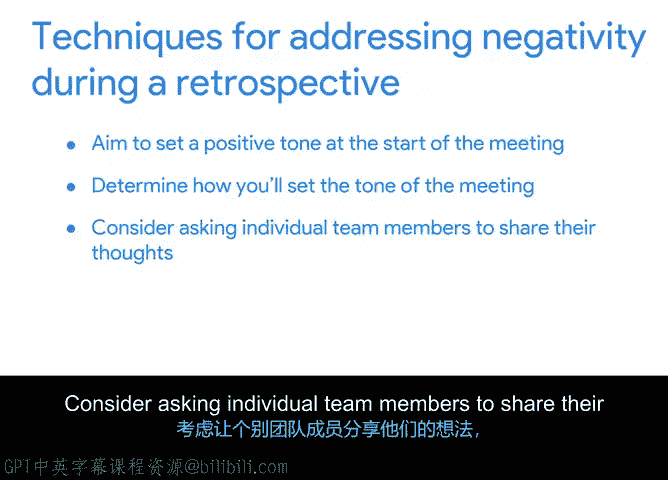

# 谷歌项目管理：专业证书 第6课：《顶尖：在现实世界中应用项目管理课程（Google）》｜applying-project-management｜ - P34：34_03_04_回顾会议处理负面情绪.zh_en - GPT中英字幕课程资源 - BV1WG411o77A

Welcome back。In the last video， we discussed some ways you can encourage accountability in a retrospective。

In this video， you'll learn how to address negativity in a retrospective。

 Thoughtfully handling negativity is an important skill you'll need in order to effectively lead productive discussions in the future。

The ability to guide discussions that break down project performance while maintaining a constructive and positive tone will help you identify and improve problem areas of a specific project。

After this video， you'll observe Peter carefully handled negativity as she leads a retrospective。

Then you'll apply similar techniques as you wrap up your own retrospective document。

Before you do your own retrospective， it's important to ask yourself。

 is this conversation likely to feel stressful for the team。Sometimes the answer will be yes。

 Let's talk about why negativity sometimes comes up during retrospective discussions。

Retrospecpecttives are a great way to build trust， honesty and direct communication with the team。

 But keep in mind， if the environment doesn't feel psychologically safe to the team。

 it's very easy for a retrospective to turn negative。

 Negativity can make it more difficult to hold a productive discussion that identifies solutions to project challenges。

If you sense subtle or even obvious negativity during a retrospective discussion。

 here are some techniques you can use to change the tone of the meeting and guide the team toward a more positive outlook to address team negativity aim to set a positive tone at the start of the meeting。

 kick off by highlighting project successes。Maybe the team received positive feedback from a stakeholder。

Or you could thank the team for their hard work in reaching a major milestone。

Determine how you'll set the tone of the meeting。Meeting props can help with this。 For example。

 you might hand out an even number of green and red index cards to each participant and ask attendees to write successes on the green cards and challenges on the red cards。

Passing out green cards might subtly encourage the team to think of successes in addition to challenges。

Even on teams with a generally positive overall dynamic。

 it's always possible for negativity to come up。 So it might be a good idea to try anticipating any potential negativity by meeting one on one with team members before the retrospective happens。

If you get the feeling that one team member is likely to bring a negative attitude to the retrospective。

 try asking yourself a few questions。Does this person feel insecure about the value they add to this team？

Does this person receive negative feedback on the quality of their work。

 Understanding the root of the negativity can help you figure out how to help the person engage with the group in a more positive way。

For example， if you sense the person is feeling insecure。

 you could try reassuring them of their value。 A single negative voice can derail otherwise productive discussions。

As the retrospective leader， it's your role to step in when one person's negativity dominates the conversation。

To deal with negative participation from an individual team member。

 consider asking team members individually to share their thoughts。

Calling on team members individually does a few things。It gives each person room to share challenges。

 It helps them model solution oriented thinking for their negative team member。

 and it discourages the negative team member from dominating the conversation by responding to every question。

Finally， you might call a meeting break。A time out is a great way to help deesscalate the situation。

 It's good to remember that there's no single technique that fits every scenario。

How you choose to address negativity will depend on the situation。Let's review。

To address negativity during a retrospective， you can aim to set a positive tone at the start of the meeting。

 determine how you'll set the tone of the meeting。 Consider asking individual team members to share their thoughts rather than posing questions to the group or call a meeting break。

In the upcoming activity， you'll observe Peter by reviewing the supporting materials as she navigates negative situations in the sauce and spoon team's retrospective。

Then you'll finish your version of the retrospective。After you've completed the upcoming activity。

 meet me in the next video to wrap up。

