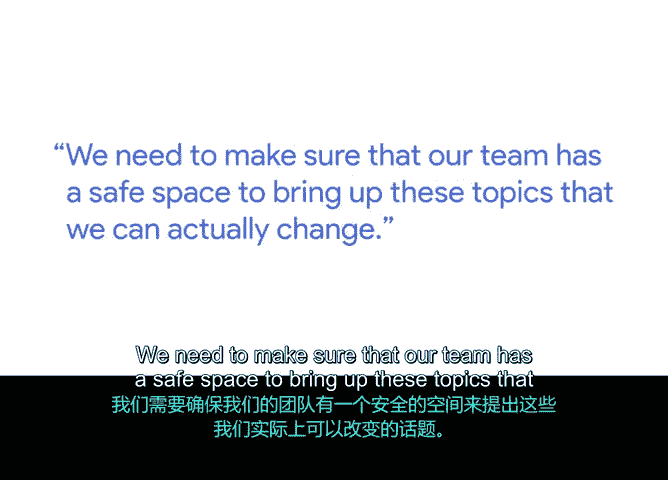

# 谷歌项目管理：专业证书 第6课：《顶尖：在现实世界中应用项目管理课程（Google）》｜applying-project-management｜ - P35：35_03_05_达娜引导积极回顾会议.zh_en - GPT中英字幕课程资源 - BV1WG411o77A

Hi， my name is Dana and I'm a site reliability manager at Google。

 a retrospective is a process that we go through at the end of every project where it helps us to look back and learn about the things that went well。

 the things that went poorly and where we get lucky it's a way for us to see if we can take the lessons that we have learned from a project and then reuse them in the next project most commonly we do retrospectives at the end of project but then sometimes if we're in the middle of the project and we find ourselves in the need to make decisions。

 we would collect a lot of the data that we would collect for an end of project retrospective and do that in the middle of the project。

 typical retrospectives have to be positive they have to be blameless and the goal is to continuously improve ourselves at our team and our processes。

If we are approaching this with a correct mindset， we are asking all the people who participate in the projects what are their individual takes on their parts of the project and on the larger scale of the project and typically these are the people who will then be working with you on next project one of the failure modes of retrospectives is when people don't really speak up and I see that quite often at sprint retrospectives where people you know sit there and don't say anything everything is fine。

And that might be for two main reasons， one， they don't really care about improving much because it it's fine。

 they tolerated it， it's the way that it is， but the second one is the one that I am more concerned with is the lack of psychological safety when they don't feel like they can actually say what they think and have that result to be all taken in by the people in the room we need to make sure that our team has a safe space to bring up these topics that we can actually change。

And we can change a lot of things in our day to day and how projects are being managed and how communication happens and what projects we pick and choose from when we do planning on an ongoing basis。

 so making sure that these venues are accessible to our team members kind of assures them that they have a stake at what happens next and they can be impactful by virtue of what they say in postparts because at least in the scope of the team。

 we will listen， we care and you can make a difference。

