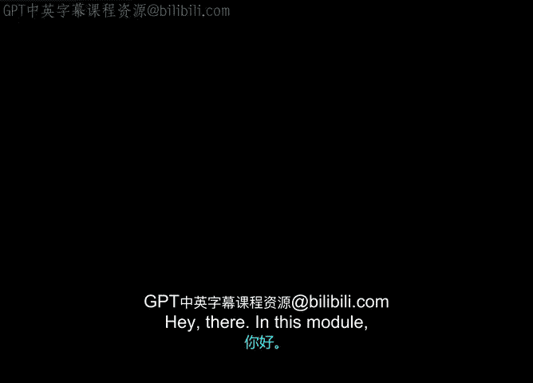
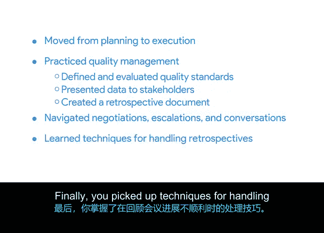

# 谷歌项目管理：专业证书 第6课：《顶尖：在现实世界中应用项目管理课程（Google）》｜applying-project-management｜ - P36：36_03_01_总结_3.zh_en - GPT中英字幕课程资源 - BV1WG411o77A

Hey there。In this module， we moved from the planning phase of the project life cyclee to the execution phase。

You practiced quality management by defining quality standards for your project。

Then you evaluated how successfully the project standards were being met and presented your findings to stakeholders。

You also created a retrospective document。We also went deeper into some concepts you learned earlier and introduced a few new approaches。

 methods and techniques along the way， you navigated negotiations。

 escalations and conversations with people in different roles with different priorities and personalities。

😊，And finally， you picked up techniques for handling retrospectives when they don't go as smoothly as planned。

 You learned how to navigate through lack of accountability。

 La of participation and negativity and retrospectives。

 which helped you draft your own retrospective for sauce and spoon to add to your portfolio of artifacts。

 Great job。😊。

Now it's time to learn even more。Meet you back here for the next set of lessons。😡。

