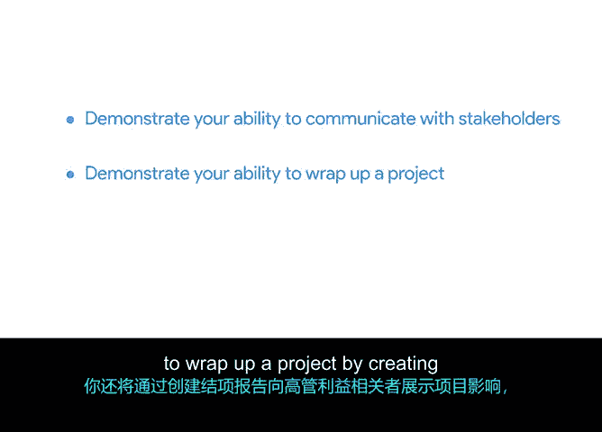

# 谷歌项目管理：专业证书 第6课：《顶尖：在现实世界中应用项目管理课程（Google）》｜applying-project-management｜ - P37：37_04_01_引言有效的利益相关方沟通.zh_en - GPT中英字幕课程资源 - BV1WG411o77A

Hey there。In the upcoming activities， we'll continue the project execution phase and then transition to the closing phase of the project lifecycle。

You'll demonstrate your ability to communicate with stakeholders by writing an email about a problem to a senior stakeholder。

You'll also demonstrate your ability to wrap up a project by creating a closeout report to present the project impact to executive stakeholders。

As you've learned throughout this program， communication is a vital part of effective project management。

That's why in the coming activities， we'll have you practice observing communication between the sauce and spoon team。

Based on those observations， you'll execute various communication techniques。

 including drafting emails to stakeholders， creating a closeout report。

 and writing an executive summary。At the end of this course。

 you'll take what you've learned and create your own personal impact report to reflect on your experience with this program。

Ready to get started？Meet me in the next video to discuss communicating about project problems。

